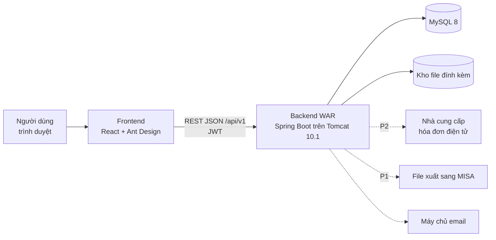
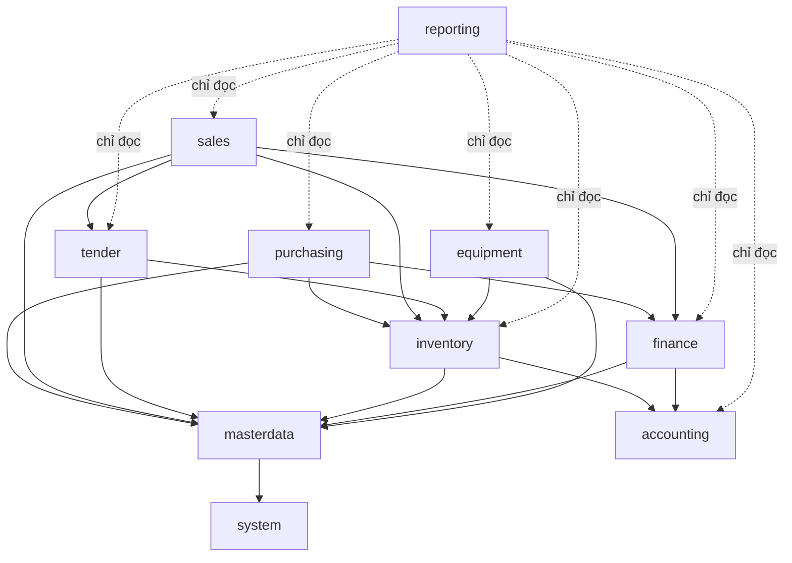
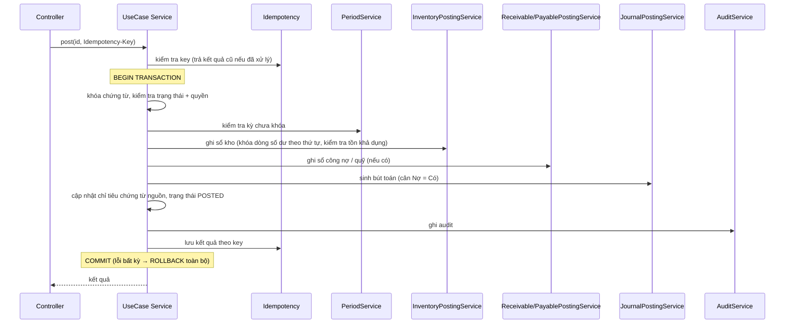
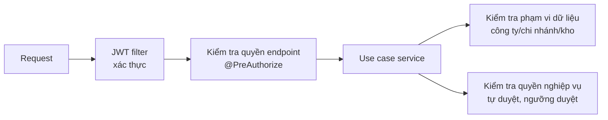
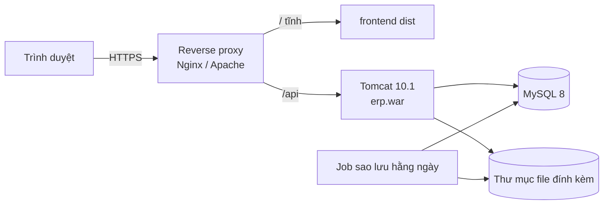

# Kiến trúc hệ thống

| Thuộc tính | Giá trị |
|---|---|
| Phiên bản | 0.2 (DRAFT) |
| Ngày cập nhật | 2026-10-09 |
| Căn cứ | `docs/01-business-requirements.md` v0.6, `CLAUDE.md`, `.claude/rules/*` |

## 1. Mục tiêu kiến trúc
- Một ứng dụng **Modular Monolith**, chia module theo 10 phân hệ nghiệp vụ, một database MySQL.
- Toàn vẹn số liệu là ưu tiên số một: tồn kho, công nợ, doanh thu, giá vốn không bị lệch (BR-GEN-P1).
- Dễ triển khai trên Tomcat 10.1 tại doanh nghiệp; môi trường dev/test dùng MySQL local, không cần Docker (D-44).
- Không tách microservices khi chưa có nhu cầu được duyệt.

## 2. Công nghệ
| Lớp | Công nghệ |
|---|---|
| Frontend | React + TypeScript (strict), Vite, Ant Design (`vi_VN`), TanStack Query |
| Backend | Java 17, Spring Boot 3.x (MVC, Data JPA/Hibernate, Security, Validation), springdoc-openapi, Lombok |
| Database | MySQL 8.x (InnoDB, utf8mb4), Flyway |
| Bảo mật | Spring Security, JWT access token + refresh token xoay vòng (D-38) |
| Logging | SLF4J + Logback, `requestId` trong MDC |
| Kiểm thử | JUnit 5, Mockito, AssertJ, Spring Boot Test, MySQL 8 local (schema `_test`), ArchUnit; Vitest + React Testing Library |
| Build | Maven 3.9+ (WAR), npm |
| Hạ tầng | MySQL 8 local + Eclipse/Tomcat 10.1 (dev/test); Tomcat 10.1 (triển khai) |

Không nâng Java 21 / Spring Boot 4.

## 3. Sơ đồ tổng thể


## 4. Module
### 4.1 Danh sách
| Gói | Phân hệ | Sở hữu dữ liệu chính |
|---|---|---|
| `common` | Hạ tầng dùng chung | Idempotency, bộ đếm số chứng từ, file đính kèm |
| `system` | M01 Quản trị hệ thống | Công ty, chi nhánh, phòng ban, người dùng, vai trò, quyền, luồng duyệt, kỳ, nhật ký, tham số |
| `masterdata` | M02 Danh mục | Hàng hóa, nhóm, đơn vị, quy đổi, đối tác, kho, vị trí, giá, thuế, tiền tệ, danh mục hồ sơ |
| `purchasing` | M03 Mua hàng | Đề nghị mua, yêu cầu báo giá, đơn mua, phiếu nhận hàng, hóa đơn mua, trả hàng NCC, phân bổ chi phí |
| `inventory` | M04 Kho | Lô, serial, phiếu nhập/xuất/chuyển, kiểm kê, điều chỉnh, sổ nhật ký kho, số dư tồn, giữ chỗ |
| `sales` | M05 Bán hàng | Bảng giá, báo giá, đơn bán, giao hàng, hóa đơn bán, trả/đổi hàng |
| `tender` | M06 Đấu thầu | Gói thầu, hồ sơ dự thầu, kết quả, hợp đồng, phụ lục, kế hoạch giao, nghiệm thu |
| `finance` | M07 Công nợ, thu chi | Sổ công nợ, phiếu thu, phiếu chi, ngân hàng, phân bổ thanh toán, tạm ứng |
| `accounting` | M08 Kế toán, giá vốn | Hệ thống tài khoản, quy tắc hạch toán, bút toán, giá vốn, khóa kỳ kế toán |
| `equipment` | M09 Thiết bị | Hồ sơ thiết bị, bảo hành, bàn giao, sửa chữa, hồ sơ sản phẩm |
| `reporting` | M10 Báo cáo | Truy vấn báo cáo, dashboard (chỉ đọc) |

### 4.2 Phụ thuộc giữa module

- Mọi module phụ thuộc `common`; `system` cung cấp ngữ cảnh người dùng, phạm vi dữ liệu, kiểm tra kỳ, luồng duyệt.
- `accounting` không phụ thuộc module nghiệp vụ: module nghiệp vụ gọi `JournalPostingService` với dữ liệu bút toán.
- `sales` gọi `tender` để kiểm tra và cập nhật số còn được giao của dòng hợp đồng.
- Không phụ thuộc vòng; kiểm tra bằng ArchUnit.

### 4.3 Tầng trong module
```
<module>/
├── api/             Controller, Request/Response DTO, mapper
├── application/     Use case service (@Transactional), API công khai cho module khác
├── domain/          Entity, enum, quy tắc, exception nghiệp vụ
└── infrastructure/  Repository, truy vấn, client ngoài
```
Module khác chỉ gọi interface trong `application` (ví dụ `InventoryPostingService`, `ReceivablePostingService`, `JournalPostingService`, `ContractQuantityService`).

## 5. Luồng ghi sổ (posting)
### 5.1 Trình tự chung


### 5.2 Sự kiện sau commit
Gửi email, thông báo, đồng bộ hóa đơn điện tử chạy **sau commit** (`@TransactionalEventListener(AFTER_COMMIT)`), không nằm trong transaction ghi sổ. Lỗi ở bước này không làm mất chứng từ đã ghi sổ; có cơ chế thử lại idempotent.

## 6. Chiến lược đồng thời
| Đối tượng | Cơ chế |
|---|---|
| Dòng số dư tồn (`inventory_balances`) | Khóa bi quan `SELECT ... FOR UPDATE` khi ghi sổ; khóa theo thứ tự tăng dần của khóa số dư để tránh deadlock |
| Giữ chỗ tồn | Khóa cùng dòng số dư khi tạo/nhả giữ chỗ |
| Dòng hợp đồng (số còn được giao) | Khóa bi quan dòng hợp đồng khi xuất/giao |
| Hóa đơn (số còn phải thu/trả) | Khóa bi quan dòng hóa đơn khi phân bổ thanh toán |
| Số dư quỹ | Khóa bi quan dòng số dư quỹ khi chi |
| Chứng từ, danh mục (sửa) | Optimistic locking `@Version`, xung đột trả `409` |
| Số chứng từ | Bảng bộ đếm, khóa dòng theo (công ty, loại, chu kỳ) |
| Gửi lại yêu cầu | `Idempotency-Key` + kiểm tra trạng thái |

Thời gian chờ khóa (`innodb_lock_wait_timeout` / `jakarta.persistence.lock.timeout`) cấu hình ngắn; hết thời gian trả lỗi để người dùng thử lại.

## 7. Bảo mật

- Access token ngắn hạn; refresh token xoay vòng, lưu băm phía server, thu hồi được.
- Phạm vi dữ liệu lấy từ security context, áp dụng ở mọi truy vấn (repository nhận tham số phạm vi).
- Chi tiết: `.claude/rules/security.md`, `docs/07-authorization.md` (sẽ lập).

## 8. Thành phần xuyên suốt
| Thành phần | Mô tả |
|---|---|
| Phản hồi API, lỗi | `ApiResponse`, `ErrorResponse`, `GlobalExceptionHandler` |
| Phân trang | `PageResponse`, giới hạn `size` tối đa 200, trường sắp xếp cho phép |
| Idempotency | Bảng `sys_idempotency_keys`, interceptor/aspect cho endpoint lệnh |
| Đánh số chứng từ | `DocumentNumberService` theo cấu hình D-03 |
| Audit | `AuditService` ghi `sys_audit_logs` (trước/sau dạng JSON) |
| Luồng duyệt | `ApprovalService` theo cấu hình ma trận duyệt |
| Kỳ | `PeriodService` kiểm tra kỳ kho, kỳ kế toán |
| Thời gian | `Clock` tiêm vào để test xác định |
| File | `AttachmentService`: kiểm tra loại thật, giới hạn kích thước, lưu ngoài web root |

## 9. Triển khai
### 9.1 Đóng gói
- Backend: WAR (`packaging=war`, `SpringBootServletInitializer`, Tomcat starter `provided`). Lý do: triển khai trên Tomcat 10.1 của doanh nghiệp (D-39). WAR vẫn chạy được bằng `java -jar` khi phát triển.
- Frontend: build tĩnh (`frontend/dist`), phục vụ qua web server/reverse proxy cùng domain với `/api`.

### 9.2 Môi trường
| Môi trường | Mục đích | Dữ liệu mẫu |
|---|---|---|
| `dev` | Phát triển: Eclipse + Tomcat 10.1, MySQL local | Có (`db/dev-data`) |
| `test` | Test tự động, MySQL local schema `_test` | Có |
| `uat` | Nghiệm thu với người dùng | Dữ liệu chuyển đổi/thử, không có dữ liệu mẫu cố định |
| `prod` | Vận hành | **Không bao giờ** |

### 9.3 Sơ đồ triển khai

Hạ tầng (D-32): kiến trúc không phụ thuộc vị trí máy chủ; mặc định một máy chủ Linux (Tomcat 10.1 + MySQL 8) tại công ty hoặc VPS trong nước, HTTPS qua reverse proxy, backup ra ngoài máy chủ. Chọn cụ thể trước Giai đoạn 11.

### 9.4 Môi trường phát triển (D-44)
Không dùng Docker. MySQL 8 local; backend chạy Eclipse + Tomcat 10.1 tại `http://localhost:8080/erp`; frontend `npm run dev` (Vite proxy `/api` sang backend). Cấu hình riêng máy ở `~/.erp/application-local.yml`.

## 10. Quyết định kiến trúc
| Mã | Quyết định | Lý do |
|---|---|---|
| ADR-01 | Modular Monolith | Quy mô nhỏ (BR-NF-10), nghiệp vụ liên kết chặt, cần transaction xuyên module |
| ADR-02 | Một database, transaction cục bộ | Ghi sổ kho + công nợ + bút toán phải nguyên tử |
| ADR-03 | Sổ phụ bất biến + bảng số dư đọc nhanh | Kiểm toán được, tái tạo được số dư |
| ADR-04 | Khóa bi quan cho số dư, optimistic cho chứng từ | Ngăn tồn âm khi xuất đồng thời (AT-04); giữ trải nghiệm sửa chứng từ |
| ADR-05 | WAR trên Tomcat 10.1 | Yêu cầu hạ tầng doanh nghiệp (D-39) |
| ADR-06 | JWT + refresh token lưu server | Frontend tách rời; thu hồi được phiên |
| ADR-07 | Báo cáo đọc trực tiếp từ sổ phụ/chứng từ | Truy ngược nguồn (BR-RPT-11); xem xét bảng tổng hợp khi hiệu năng không đạt |

Thay đổi kiến trúc phải cập nhật tài liệu này trước khi triển khai và được duyệt.
