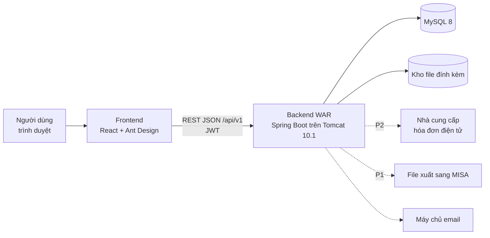
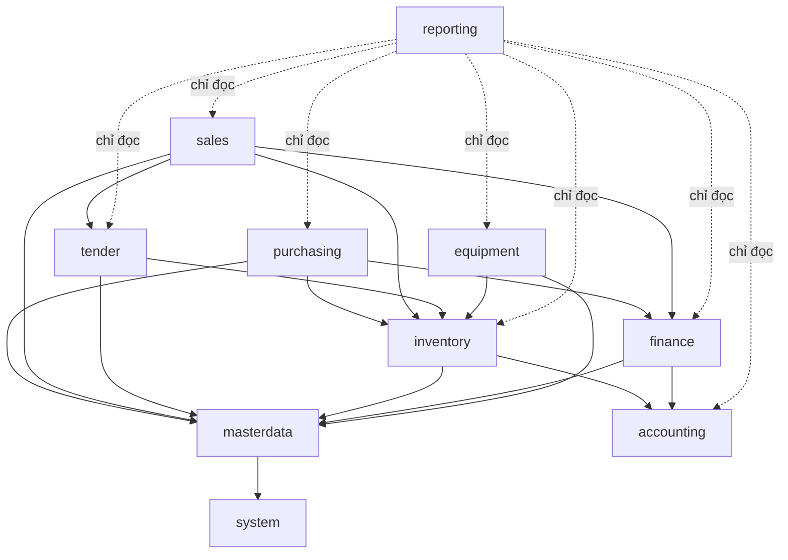
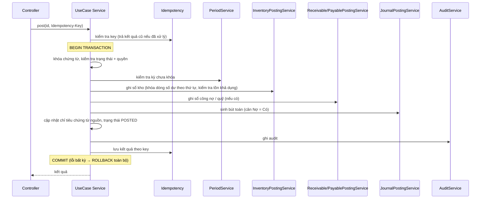
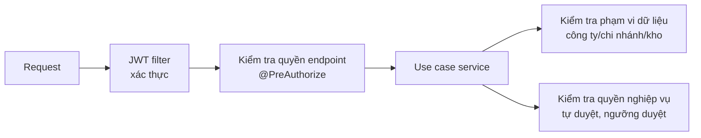
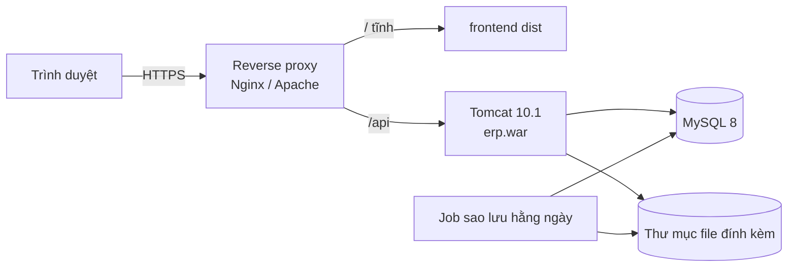

# Kiến trúc hệ thống

| Thuộc tính | Giá trị |
|---|---|
| Phiên bản | 0.2 (DRAFT) |
| Ngày cập nhật | 2026-10-10 |
| Căn cứ | `docs/01-business-requirements.md` v0.6, `CLAUDE.md`, `.claude/rules/*` |

## 1. Mục tiêu kiến trúc
- Một ứng dụng **Modular Monolith**, chia module theo 10 phân hệ nghiệp vụ, một database MySQL.
- Toàn vẹn số liệu là ưu tiên số một: tồn kho, công nợ, doanh thu, giá vốn không bị lệch (BR-GEN-P1).
- Dễ triển khai trên Tomcat 10.1 tại doanh nghiệp; môi trường dev/test dùng MySQL local, không cần Docker (D-44).
- Không tách microservices khi chưa có nhu cầu được duyệt.

## 2. Công nghệ
| Lớp | Công nghệ |
|---|---|
| Frontend | React + TypeScript (strict), Vite, Ant Design (`vi_VN`), TanStack Query |
| Backend | Java 17, Spring Boot 3.x (MVC, Data JPA/Hibernate, Security, Validation), springdoc-openapi, Lombok |
| Database | MySQL 8.x (InnoDB, utf8mb4), Flyway |
| Bảo mật | Spring Security, JWT access token + refresh token xoay vòng (D-38) |
| Logging | SLF4J + Logback, `requestId` trong MDC |
| Kiểm thử | JUnit 5, Mockito, AssertJ, Spring Boot Test, MySQL 8 local (schema `_test`), ArchUnit; Vitest + React Testing Library |
| Build | Maven 3.9+ (WAR), npm |
| Hạ tầng | MySQL 8 local + Eclipse/Tomcat 10.1 (dev/test); Tomcat 10.1 (triển khai) |

Không nâng Java 21 / Spring Boot 4.

## 3. Sơ đồ tổng thể


## 4. Module
### 4.1 Danh sách
| Gói | Phân hệ | Sở hữu dữ liệu chính |
|---|---|---|
| `common` | Hạ tầng dùng chung | Idempotency, bộ đếm số chứng từ, file đính kèm |
| `system` | M01 Quản trị hệ thống | Công ty, chi nhánh, phòng ban, người dùng, vai trò, quyền, luồng duyệt, kỳ, nhật ký, tham số |
| `masterdata` | M02 Danh mục | Hàng hóa, nhóm, đơn vị, quy đổi, đối tác, kho, vị trí, giá, thuế, tiền tệ, danh mục hồ sơ |
| `purchasing` | M03 Mua hàng | Đơn mua (chứng từ ghi sổ duy nhất, D-54), trả hàng / giảm giá NCC, phân bổ chi phí |
| `inventory` | M04 Kho | Lô, serial, phiếu nhập/xuất/chuyển, kiểm kê, điều chỉnh, sổ nhật ký kho, số dư tồn, giữ chỗ |
| `sales` | M05 Bán hàng | Bảng giá, đơn bán (chứng từ ghi sổ duy nhất, D-54), trả / đổi hàng, hàng lỗi, báo cáo doanh số |
| `tender` | M06 Đấu thầu | Gói thầu, hồ sơ dự thầu, kết quả, hợp đồng, phụ lục, kế hoạch giao, nghiệm thu |
| `finance` | M07 Công nợ, thu chi | Sổ công nợ, phiếu thu, phiếu chi, ngân hàng, phân bổ thanh toán, tạm ứng |
| `accounting` | M08 Kế toán, giá vốn | Hệ thống tài khoản, quy tắc hạch toán, bút toán, giá vốn, khóa kỳ kế toán |
| `equipment` | M09 Thiết bị | Hồ sơ thiết bị, bảo hành, bàn giao, sửa chữa, hồ sơ sản phẩm |
| `reporting` | M10 Báo cáo | Truy vấn báo cáo, dashboard (chỉ đọc) |

### 4.2 Phụ thuộc giữa module

- Mọi module phụ thuộc `common`; `system` cung cấp ngữ cảnh người dùng, phạm vi dữ liệu, kiểm tra kỳ, luồng duyệt.
- `accounting` không phụ thuộc module nghiệp vụ: module nghiệp vụ gọi `JournalPostingService` với dữ liệu bút toán.
  - Module nghiệp vụ gửi **dòng hạch toán theo mã nghiệp vụ** (ví dụ `RECEIPT_CUSTOMER`) kèm số tiền và chiều phân tích; `accounting` tra `posting_rules` (loại chứng từ + mã nghiệp vụ + loại hàng / vai trò đối tượng nếu có) ra tài khoản Nợ / Có (ADR-11).
  - Một vế của quy tắc được để trống khi tài khoản do chứng từ quyết định (ví dụ tài khoản tiền của quỹ / tài khoản ngân hàng); chứng từ truyền tài khoản đó, thiếu thì lỗi `POSTING_RULE_INCOMPLETE`.
  - Từ 4C, quy tắc được để trống **cả hai vế** khi chứng từ quyết định cả hai tài khoản (thu chi khác: tài khoản đối ứng theo dòng; chuyển tiền nội bộ: tài khoản của hai quỹ). Quy tắc vẫn bắt buộc có: thiếu quy tắc thì `POSTING_RULE_NOT_FOUND`, nên kế toán trưởng vẫn kiểm soát nghiệp vụ nào được hạch toán (sửa đổi ADR-11).
  - `accounting` chỉ phụ thuộc `common` và `system` (kiểm tra kỳ kế toán `ACCOUNTING`).
- `finance` sở hữu sổ công nợ và sổ quỹ; hóa đơn bán / mua (Giai đoạn 5, 6) gọi `DebtPostingService` của `finance`, không ghi bảng công nợ trực tiếp (ADR-12).
  - `DebtPostingService` (`record`, `reverse`): tạo / đảo khoản công nợ (công nợ đầu kỳ, tạm ứng, điều chỉnh tăng; hóa đơn ở Giai đoạn 5, 6).
  - `DebtSettlementService` (4D, tách từ `DebtPostingService` để mỗi lớp < 400 dòng): `settle` (phân bổ, trả trước), `applyPrepayment` (bù trừ trả trước), `reverseSettlement` (hoàn phân bổ, hoàn trả trước), dùng cho phiếu thu / chi, bù trừ, điều chỉnh giảm, thanh toán tạm ứng.
  - Chứng từ công nợ, quỹ kế thừa `FinanceDocument` (cột và vòng đời nhóm A chung); `FinanceDocumentFlow` gom tìm kiếm theo phạm vi, gửi duyệt / duyệt / từ chối / hủy, chống xử lý trùng, audit cho DTCN, DCCN, TTTU, KKQ (4D).
  - Chứng từ thu chi (`cash_documents`, ADR-13) ghi sổ quỹ, phân bổ công nợ và gọi `JournalPostingService` trong cùng transaction; tài khoản tiền lấy từ quỹ (`cash_accounts.gl_account_id`), tra qua `AccountLookupService` (API công khai của `accounting`).
- `sales` gọi `tender` để kiểm tra và cập nhật số còn được giao của dòng hợp đồng.
- Không phụ thuộc vòng; kiểm tra bằng ArchUnit.

### 4.3 Tầng trong module
```
<module>/
├── api/             Controller, Request/Response DTO, mapper
├── application/     Use case service (@Transactional), API công khai cho module khác
├── domain/          Entity, enum, quy tắc, exception nghiệp vụ
└── infrastructure/  Repository, truy vấn, client ngoài
```
Module khác chỉ gọi interface trong `application` (ví dụ `InventoryPostingService`, `ReceivablePostingService`, `JournalPostingService`, `ContractQuantityService`).

## 5. Luồng ghi sổ (posting)
### 5.1 Trình tự chung


### 5.2 Sự kiện sau commit
Gửi email, thông báo, đồng bộ hóa đơn điện tử chạy **sau commit** (`@TransactionalEventListener(AFTER_COMMIT)`), không nằm trong transaction ghi sổ. Lỗi ở bước này không làm mất chứng từ đã ghi sổ; có cơ chế thử lại idempotent.

## 6. Chiến lược đồng thời
| Đối tượng | Cơ chế |
|---|---|
| Dòng số dư tồn (`inventory_balances`) | Khóa bi quan `SELECT ... FOR UPDATE` khi ghi sổ; khóa theo thứ tự tăng dần của khóa số dư để tránh deadlock |
| Giữ chỗ tồn | Khóa cùng dòng số dư khi tạo/nhả giữ chỗ |
| Dòng hợp đồng (số còn được giao) | Khóa bi quan dòng hợp đồng khi xuất/giao |
| Hóa đơn (số còn phải thu/trả) | Khóa bi quan dòng hóa đơn khi phân bổ thanh toán |
| Số dư quỹ | Khóa bi quan dòng số dư quỹ khi chi |
| Chứng từ, danh mục (sửa) | Optimistic locking `@Version`, xung đột trả `409` |
| Số chứng từ | Bảng bộ đếm, khóa dòng theo (công ty, chi nhánh, loại, kỳ `YYYY`/`YYYYMM`); dòng bộ đếm tạo trước trong transaction riêng. Cấu hình định dạng chỉ đổi từ chu kỳ sau (D-48) nên không cần khóa cấu hình khi cấp số |
| Khóa kỳ ↔ ghi sổ (BR-SYS-30, AT-11) | `PeriodGuard.assertOpen` (bắt buộc trong transaction ghi sổ) đọc kỳ bằng `FOR SHARE`; khóa/mở kỳ lấy `FOR UPDATE` trên kỳ đích và kỳ liền kề theo thứ tự id. Hai bên loại trừ nhau: kỳ không thể bị khóa giữa lúc kiểm tra và commit chứng từ. Dòng `period_locks` tạo trước trong transaction riêng (sau khi khóa kỳ) để mọi khóa dòng rơi vào dòng đã tồn tại, tránh deadlock do gap lock |
| Ghi sổ kho (BR-INV-20, AT-04) | Transaction ghi sổ chạy mức cô lập **READ COMMITTED**: đọc số dư mới nhất sau khi khóa, không có gap lock khi tạo dòng số dư mới. Thứ tự khóa cố định: (1) kỳ `FOR SHARE`; (2) trạng thái kho (`inventory_warehouse_states`) `FOR SHARE`; (3) tổng (hàng, kho) `FOR UPDATE` theo (hàng, kho) tăng dần, gồm cả cặp của kho nhận khi chuyển kho; (4) dòng tồn chi tiết `FOR UPDATE OF b` theo FEFO; (5) serial theo id tăng dần; (6) chính sách xuất vượt tồn. Giảm tồn bằng `UPDATE ... WHERE on_hand >= q`; tăng tồn bằng upsert `ON DUPLICATE KEY UPDATE`. Dòng tổng / serial đã có thì khóa ghi ngay (`SELECT ... FOR UPDATE`, hoặc `INSERT ... ON DUPLICATE KEY UPDATE` khi tạo mới), **không dùng `INSERT IGNORE` rồi `FOR UPDATE`**: cách đó lấy khóa chia sẻ rồi nâng lên khóa ghi, hai giao dịch cùng nâng sẽ deadlock (phát hiện bằng test AT-04) |
| Kiểm kê ↔ ghi sổ (D-11) | Bắt đầu đếm lấy `FOR UPDATE` trên dòng trạng thái kho (chờ các lần ghi sổ đang chạy kết thúc) rồi đặt `counting_stock_count_id`; mọi lần ghi sổ đọc dòng này `FOR SHARE` và bị chặn (`STOCK_COUNT_IN_PROGRESS`) trừ phiếu điều chỉnh sinh từ chính phiếu kiểm kê |
| Duyệt chứng từ (BR-SYS-11) | Yêu cầu duyệt tìm theo chứng từ rồi khóa theo khóa chính (`findByIdForUpdate`); unique `pending_flag` chặn hai yêu cầu đang chờ cho cùng chứng từ |
| Bút toán (BR-ACC-03) | Ghi trong transaction ghi sổ của chứng từ nguồn (`Propagation.MANDATORY`). Mỗi chứng từ nguồn có tối đa một bút toán gốc và một bút toán đảo cho mỗi bút toán gốc (unique `company_id, source_type, source_id, reversal_key`): gửi lại không sinh bút toán trùng. Bút toán và dòng bút toán chỉ INSERT; đảo đổi trạng thái bút toán gốc sang `REVERSED` sau khi khóa dòng bút toán gốc `FOR UPDATE` |
| Khoản công nợ, số dư quỹ (Giai đoạn 4B, 4C) | Ghi sổ / đảo chứng từ thu chi chạy READ COMMITTED (như ghi sổ kho, ADR-08). Thứ tự khóa cố định: (1) chứng từ `FOR UPDATE`; (2) quỹ (`cash_accounts`) `FOR UPDATE` theo id tăng dần, gồm cả quỹ nhận khi chuyển tiền; (3) khoản công nợ `FOR UPDATE` theo id tăng dần (phân bổ tự động khóa mọi khoản còn nợ của đối tượng trong chi nhánh rồi sắp theo hạn). Từ 4D thêm dòng trả trước của đối tượng (`debt_prepayments`) khóa trước khoản công nợ: (1) chứng từ; (2) quỹ; (3) dòng trả trước (tạo bằng `INSERT ... ON DUPLICATE KEY UPDATE` để lấy khóa ghi ngay); (4) khoản công nợ. Kiểm tra số dư quỹ tiền mặt, trả trước còn lại và số còn lại của hóa đơn **sau khi khóa**; `CHECK` trong DB (`balance >= 0` với quỹ tiền mặt, `settled_amount <= original_amount`) là chốt chặn cuối. Test `CashIntegrationTest` chạy hai luồng cùng phân bổ một hóa đơn và cùng chi một quỹ |
| Đơn mua (D-54) | Duyệt / hủy đơn đã duyệt: (1) đơn mua `FOR UPDATE`; (2) tổng (hàng, kho) `FOR UPDATE` theo (hàng, kho) tăng dần, cộng / trừ `incoming_quantity` bằng `UPDATE ... WHERE incoming + q >= 0` (`CHECK incoming_quantity >= 0` là chốt chặn cuối). Ghi sổ / đảo chạy READ COMMITTED: (1) đơn mua; (2) phần ghi sổ kho của `StockInService` (kỳ, trạng thái kho, tổng (hàng, kho), tồn chi tiết, serial); (3) hàng đang về trên cùng dòng tổng đã khóa; (4) khoản công nợ (`DebtPostingService.recordInvoice` / `reverse`); (5) bút toán. Phiếu nhập kho do module mua lập và ghi sổ ngay qua `StockInService` (không qua luồng duyệt phiếu kho: đơn mua là chứng từ được duyệt); đảo chỉ qua đơn mua (`/inventory-documents/{id}/reverse` trả 409 cho chứng từ có nguồn). Chống trùng hóa đơn NCC (MST, ký hiệu, số) bằng cột `duplicate_key` unique theo công ty (NULL khi không có hóa đơn, hủy, đảo). Đảo bị chặn khi dòng còn trả hàng / giảm giá / phân bổ chưa đảo |
| Trả hàng NCC, giảm giá hàng mua, phân bổ chi phí mua | READ COMMITTED. Trả hàng / giảm giá: (1) chứng từ `FOR UPDATE`; (2) đơn mua; (3) ghi sổ kho của `StockOutService` (phiếu xuất PXK có nguồn, đúng lô / serial); (4) dòng trả trước rồi khoản công nợ (`DebtPostingService.reduceInvoice` gọi `DebtSettlementService.settle`, cùng thứ tự với thu / chi); (5) bút toán. Phân bổ chi phí: (1) chứng từ; (2) đơn mua có dòng chi phí theo id tăng dần; (3) bút toán. Kiểm tra số còn trả / giá trị còn lại của dòng đơn sau khi khóa |
| Giữ chỗ khi xuất kho theo chứng từ nguồn (Giai đoạn 5D, dùng ở Giai đoạn 6) | `StockOutService` khóa mọi tổng (hàng, kho) của phiếu theo thứ tự tăng dần rồi mới giảm giữ chỗ được dùng (`InventoryReservationService.consume`), sau đó ghi sổ kho (khóa lại các dòng đã giữ); giữ chỗ nhiều dòng (`reserveAll`) và nhả (`releaseAll`, nhả quá hạn) cũng khóa tổng theo thứ tự trước khi khóa giữ chỗ |
| Bán hàng (D-54) | READ COMMITTED cho mọi lệnh đổi tồn / công nợ. Duyệt / giữ / nhả hàng / hủy đơn: đơn → tổng (hàng, kho) theo thứ tự → giữ chỗ. Ghi sổ đơn: đơn → `StockOutService` (khóa mọi tổng của phiếu theo thứ tự trước khi dùng giữ chỗ, rồi tồn chi tiết, serial) → nhả giữ chỗ còn lại → khoản công nợ → bút toán. Đảo đơn (kể cả giao thất bại): đơn → `StockOutService.reverse` → công nợ → bút toán. Trả hàng / giảm giá bán: chứng từ → đơn → `StockInService` → dòng trả trước rồi khoản công nợ (`reduceInvoice`) → bút toán. Kiểm tra số còn trả theo dòng và lô sau khi khóa. Số hóa đơn điện tử: kiểm tra trùng trước khi đổi đơn (cột `einvoice_key` unique theo công ty là chốt chặn cuối) |
| Gửi lại yêu cầu | `Idempotency-Key` + kiểm tra trạng thái |

Thời gian chờ khóa (`innodb_lock_wait_timeout` / `jakarta.persistence.lock.timeout`) cấu hình ngắn; hết thời gian trả lỗi để người dùng thử lại.

## 7. Bảo mật

- Access token ngắn hạn; refresh token xoay vòng, lưu băm phía server, thu hồi được.
- Phạm vi dữ liệu lấy từ security context, áp dụng ở mọi truy vấn (repository nhận tham số phạm vi).
- Chi tiết: `.claude/rules/security.md`, `docs/07-authorization.md` (sẽ lập).

## 8. Thành phần xuyên suốt
| Thành phần | Mô tả |
|---|---|
| Phản hồi API, lỗi | `ApiResponse`, `ErrorResponse`, `GlobalExceptionHandler` |
| Phân trang | `PageResponse`, giới hạn `size` tối đa 200, trường sắp xếp cho phép |
| Idempotency | Bảng `sys_idempotency_keys`, interceptor/aspect cho endpoint lệnh |
| Đánh số chứng từ | `DocumentNumberService` theo cấu hình D-03 |
| Audit | `AuditService` ghi `sys_audit_logs` (trước/sau dạng JSON) |
| Luồng duyệt | `ApprovalService` theo cấu hình ma trận duyệt |
| Kỳ | `PeriodService` kiểm tra kỳ kho, kỳ kế toán |
| Thời gian | `Clock` tiêm vào để test xác định |
| File | `AttachmentService`: kiểm tra loại thật, giới hạn kích thước, lưu ngoài web root |

## 9. Triển khai
### 9.1 Đóng gói
- Backend: WAR (`packaging=war`, `SpringBootServletInitializer`, Tomcat starter `provided`). Lý do: triển khai trên Tomcat 10.1 của doanh nghiệp (D-39). WAR vẫn chạy được bằng `java -jar` khi phát triển.
- Frontend: build tĩnh (`frontend/dist`), phục vụ qua web server/reverse proxy cùng domain với `/api`.

### 9.2 Môi trường
| Môi trường | Mục đích | Dữ liệu mẫu |
|---|---|---|
| `dev` | Phát triển: Eclipse + Tomcat 10.1, MySQL local | Có (`db/dev-data`) |
| `test` | Test tự động, MySQL local schema `_test` | Có |
| `uat` | Nghiệm thu với người dùng | Dữ liệu chuyển đổi/thử, không có dữ liệu mẫu cố định |
| `prod` | Vận hành | **Không bao giờ** |

### 9.3 Sơ đồ triển khai

Hạ tầng (D-32): kiến trúc không phụ thuộc vị trí máy chủ; mặc định một máy chủ Linux (Tomcat 10.1 + MySQL 8) tại công ty hoặc VPS trong nước, HTTPS qua reverse proxy, backup ra ngoài máy chủ. Chọn cụ thể trước Giai đoạn 11.

### 9.4 Môi trường phát triển (D-44)
Không dùng Docker. MySQL 8 local; backend chạy Eclipse + Tomcat 10.1 tại `http://localhost:8080/erp`; frontend `npm run dev` (Vite proxy `/api` sang backend). Cấu hình riêng máy ở `~/.erp/application-local.yml`.

## 10. Quyết định kiến trúc
| Mã | Quyết định | Lý do |
|---|---|---|
| ADR-01 | Modular Monolith | Quy mô nhỏ (BR-NF-10), nghiệp vụ liên kết chặt, cần transaction xuyên module |
| ADR-02 | Một database, transaction cục bộ | Ghi sổ kho + công nợ + bút toán phải nguyên tử |
| ADR-03 | Sổ phụ bất biến + bảng số dư đọc nhanh | Kiểm toán được, tái tạo được số dư |
| ADR-04 | Khóa bi quan cho số dư, optimistic cho chứng từ | Ngăn tồn âm khi xuất đồng thời (AT-04); giữ trải nghiệm sửa chứng từ |
| ADR-05 | WAR trên Tomcat 10.1 | Yêu cầu hạ tầng doanh nghiệp (D-39) |
| ADR-06 | JWT + refresh token lưu server | Frontend tách rời; thu hồi được phiên |
| ADR-07 | Báo cáo đọc trực tiếp từ sổ phụ/chứng từ | Truy ngược nguồn (BR-RPT-11); xem xét bảng tổng hợp khi hiệu năng không đạt |
| ADR-08 | Ghi sổ kho ở READ COMMITTED, thứ tự khóa cố định (mục 6) | REPEATABLE READ mặc định của MySQL gây gap lock khi nhiều phiếu cùng tạo dòng số dư mới và đọc ảnh chụp cũ sau khi chờ khóa. Chứng minh bằng test AT-04. Duyệt 2026-10-10 |
| ADR-09 | Đảo phụ thuộc giữa module bằng interface | Module cấp thấp (`system`, `masterdata`) khai báo interface (`PostingActivityProbe`, `PeriodCloseCheck`, `ProductUsageProbe`, `TrackedItemDirectory`, `WarehouseDirectory`); module kho triển khai. Không phát sinh phụ thuộc vòng (ArchUnit) |
| ADR-10 | Một bảng chứng từ kho chung `inventory_documents` có `document_type` | Bảy loại phiếu kho (PNK, PXK, PXH, PCK, PDC, PCL, PDK) dùng chung cấu trúc đầu / dòng và một luồng ghi sổ; tránh lặp mã. Thay cho dự kiến bảng riêng từng loại ở docs/03 bản trước. API tương ứng `/inventory-documents`. Duyệt 2026-10-10 |
| ADR-11 | Quy tắc hạch toán là dữ liệu cấu hình (`posting_rules`), module nghiệp vụ gửi mã nghiệp vụ thay vì số tài khoản | Quy tắc kế toán chờ kế toán trưởng rà soát (D-02, D-26, D-34, D-35); đổi tài khoản không cần sửa mã. Quy tắc cụ thể hơn (có loại hàng / vai trò đối tượng) thắng quy tắc chung. Duyệt 2026-10-10 (kế hoạch Giai đoạn 4) |
| ADR-12 | Khoản công nợ gắn chứng từ nguồn tổng quát (`source_type`, `source_id`) thay cho `invoice_id` | Giai đoạn 4 cần công nợ đầu kỳ theo từng hóa đơn cũ (MISA) trước khi có hóa đơn bán / mua (Giai đoạn 5, 6); hóa đơn sau này dùng cùng `DebtPostingService`. Duyệt 2026-10-10 |
| ADR-13 | Một bảng chứng từ thu chi `cash_documents` có `document_type` (PT, PC, BC, UNC, CTN) và `purpose` (thu tiền khách, trả nhà cung cấp, thu khác, chi khác, chuyển tiền) | Năm loại chứng từ dùng chung đầu / dòng, luồng duyệt, ghi sổ, đảo (như ADR-10 cho kho); thay cho dự kiến `cash_receipts`, `cash_payments`, `cash_transfers` ở docs/03 bản trước. `purpose` là mã nghiệp vụ tra quy tắc hạch toán. Duyệt 2026-10-10 (người dùng giao tự duyệt theo khuyến cáo khi làm 4C) |
| ADR-16 | Module `sales` có lớp cha `SalesDocument` (thêm cột nhân viên kinh doanh `sales_user_id`) và luồng `SalesDocumentFlow` riêng; "chỉ dữ liệu của mình" (BR-SYS-04) lọc theo nhân viên phụ trách hoặc người lập. Tra giá qua `PriceQueryService` (masterdata), mức công nợ qua `DebtExposureService` (finance), tồn khả dụng qua `StockAvailabilityService` (inventory), xuất / nhập kho theo chứng từ nguồn qua `StockOutService` / `StockInService`. Phần phiếu giao, hóa đơn bán, báo giá, bán nhanh, đề nghị mua từ đơn **thay bằng ADR-17** | Giữ ranh giới module (sales chỉ gọi API công khai tầng application). Người dùng giao làm hết Giai đoạn 6 theo khuyến cáo (2026-10-10) |
| ADR-15 | Module `purchasing` có lớp cha `PurchaseDocument` và luồng `PurchaseDocumentFlow` riêng; hàng đang về lưu ở `inventory_stock_summaries.incoming_quantity`, chỉ cập nhật qua API công khai `IncomingStockService` của module kho; phiếu nhập kho mua hàng vẫn thuộc module kho (cột chứng từ nguồn). Phần chứng từ điều phối nhóm B (đề nghị mua, đơn mua nhiều đợt nhận) **thay bằng ADR-17** | Module mua hàng không được ghi bảng tồn của module kho (ranh giới module); hàng đang về đọc nhanh cùng dòng tổng (hàng, kho) đã có. Duyệt 2026-10-10 (người dùng giao "duyệt, tự chốt") |
| ADR-14 | Tạm ứng nhân viên là loại công nợ thứ ba (`debt_type = ADVANCE`, tăng ở vế Nợ) trong `debt_items`; điều chỉnh công nợ (DCCN) và thanh toán tạm ứng (TTTU) dùng chung bảng `debt_adjustment_documents`; tiền trả trước có bảng số dư `debt_prepayments` khóa được | Tạm ứng cần hạn, tuổi, phân bổ, đối chiếu như phải thu nên dùng lại sổ công nợ thay bảng `employee_advances` dự kiến; thanh toán tạm ứng là điều chỉnh giảm có tài khoản chi phí; trả trước cần dòng khóa để hai chứng từ bù trừ đồng thời không dùng quá (BR-GEN-52) và đảo phiếu thu không xóa trả trước đã bù trừ. Duyệt 2026-10-10 (người dùng giao làm 4D theo khuyến cáo) |

| ADR-17 | Gộp chứng từ mua / bán (D-54): đơn mua và đơn bán là chứng từ ghi sổ (nhóm A) duy nhất của nghiệp vụ. Ghi sổ đơn mua gọi `StockInService` (phiếu nhập kho PNK nguồn `DMH`), `IncomingStockService`, `DebtPostingService.recordInvoice` (nguồn `DMH`), `JournalPostingService` (quy tắc hạch toán DMH) trong một transaction. Ghi sổ đơn bán gọi `StockOutService` (phiếu xuất PXK nguồn `DBH`, loại SALE, dùng giữ chỗ của đơn), `DebtPostingService.recordInvoice` (nguồn `DBH`), `JournalPostingService` (quy tắc DBH). Hàng thực xuất lưu ở `sales_order_items`; theo dõi giao hàng và số hóa đơn điện tử là cột của đơn. Trả hàng / giảm giá / phân bổ chi phí tham chiếu dòng đơn đã ghi sổ; công nợ giảm theo khoản của đơn (`reduceInvoice` với nguồn `DMH` / `DBH`). Bỏ bảng và API đề nghị mua, phiếu nhận, hóa đơn mua, báo giá, phiếu giao, hóa đơn bán, bán nhanh (migration V22, V23) | Người dùng muốn chỉ một màn hình đơn mua / đơn bán, chấp nhận mất nhận / giao nhiều đợt cho một đơn. Chủ dự án duyệt 2026-10-12 |
Thay đổi kiến trúc phải cập nhật tài liệu này trước khi triển khai và được duyệt.
