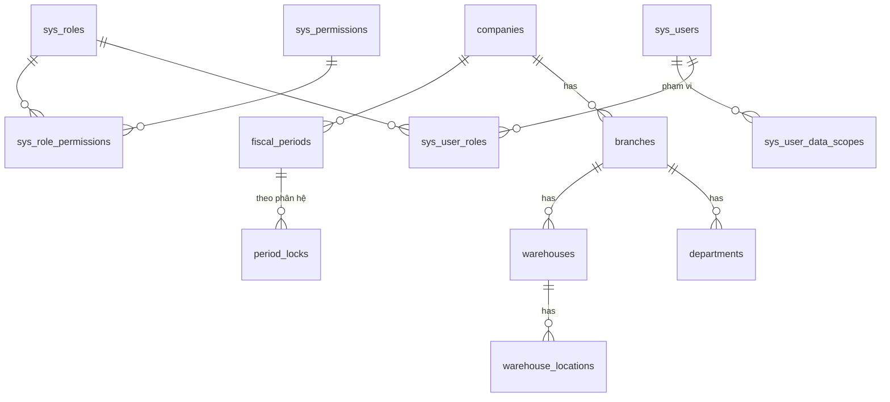
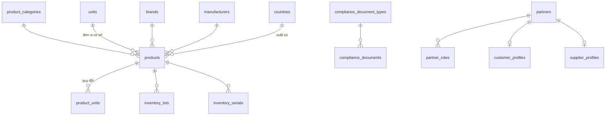
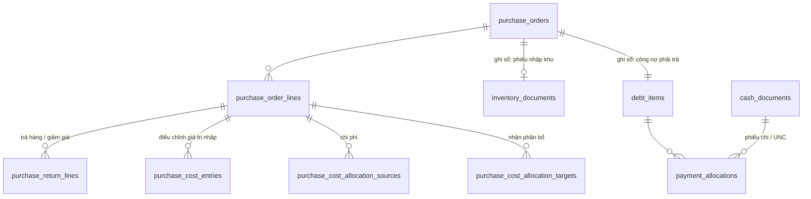
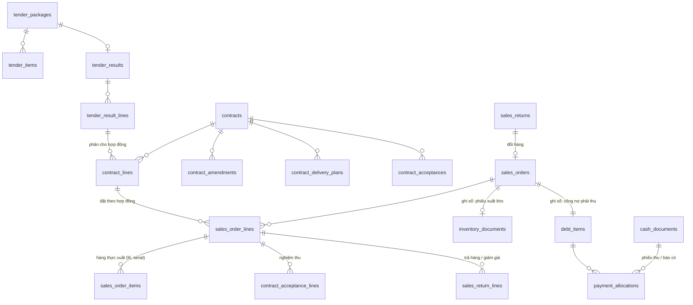
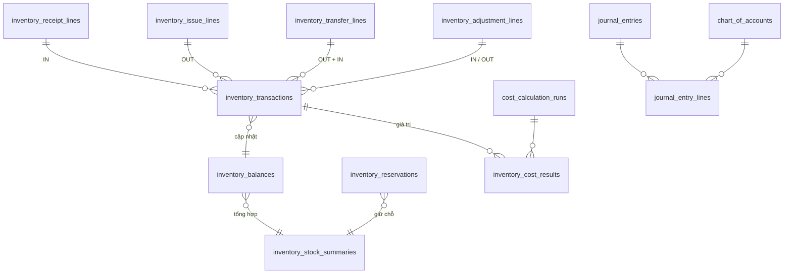
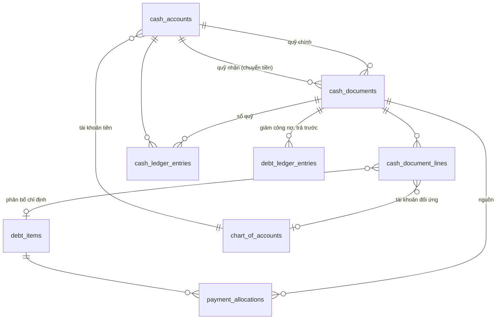

# Thiết kế cơ sở dữ liệu - ERD và data dictionary

| Thuộc tính | Giá trị |
|---|---|
| Phiên bản | 0.6 (đến Giai đoạn 4D) |
| Ngày cập nhật | 2026-10-10 |
| Database | MySQL 8.x, InnoDB, `utf8mb4_0900_ai_ci` |
| Căn cứ | `docs/01-business-requirements.md` v0.6, `.claude/rules/database.md` |

Tài liệu này là **mô hình logic**. Cột chi tiết của từng bảng được chốt khi thiết kế module tương ứng và phải cập nhật tại đây cùng lúc với migration Flyway.

**Migration đã có:**

| Phiên bản | File | Bảng |
|---|---|---|
| V1 | `backend/src/main/resources/db/migration/V1__create_common_tables.sql` | `document_sequences`, `sys_idempotency_keys`, `sys_audit_logs` (đúng mục 4.13–4.15). Chưa có FK `company_id`/`branch_id`; đã thêm ở V2 |
| V2 | `.../V2__create_organization_and_security.sql` | `companies`, `branches`, `departments`, `sys_users`, `sys_roles`, `sys_permissions`, `sys_user_roles`, `sys_role_permissions`, `sys_user_data_scopes`, `sys_refresh_tokens`, `sys_login_logs`; FK cho bảng V1; danh mục quyền M01 và 17 vai trò mặc định (mục 4.17) |
| V3 | `.../V3__create_periods_parameters_numbering.sql` | `fiscal_periods`, `period_locks`, `sys_parameter_definitions`, `sys_parameters`, `document_number_formats` (mục 4.18–4.20); 3 tham số D-05; 7 quyền mới và gán quyền mặc định (docs/07 mục 3) |

Dữ liệu mẫu dev/test: `db/dev-data/R__dev_organization_and_users.sql` (1 công ty, 2 chi nhánh, 3 phòng ban, 6 người dùng, 12 kỳ tháng năm 2026; docs/07 mục 5).

## 1. Quy ước

### 1.1 Đặt tên
- Bảng snake_case số nhiều; dòng chứng từ `<chứng_từ>_lines`; bảng hệ thống tiền tố `sys_`.
- PK `id BIGINT AUTO_INCREMENT`; FK `<thực_thể>_id`.
- Index `idx_<bảng>_<cột>`, unique `uk_<bảng>_<cột>`, FK `fk_<bảng>_<bảng_tham_chiếu>`.

### 1.2 Kiểu dữ liệu
| Dữ liệu | Kiểu |
|---|---|
| Tiền | `DECIMAL(19,4)`; hiển thị làm tròn đến đồng (D-05) |
| Đơn giá | `DECIMAL(19,4)` |
| Số lượng | `DECIMAL(19,3)` (D-05) |
| Hệ số quy đổi, tỷ giá | `DECIMAL(19,6)` |
| Ngày chứng từ, ngày hạch toán, hạn dùng | `DATE` |
| Thời điểm | `DATETIME(3)` UTC |
| Trạng thái, loại | `VARCHAR(30)` ánh xạ enum |

### 1.3 Nhóm cột chuẩn
| Nhóm | Cột | Áp dụng |
|---|---|---|
| Audit | `created_by, created_at, updated_by, updated_at` | Danh mục, chứng từ |
| Khóa lạc quan | `version INT NOT NULL DEFAULT 0` | Danh mục, chứng từ, bảng có sửa đồng thời |
| Tổ chức | `company_id, branch_id` | Chứng từ, dữ liệu có phạm vi |
| Chứng từ | `document_no, document_date, posting_date, status, description` | Mọi chứng từ |
| Quy trình | `submitted_by/at, approved_by/at, posted_by/at, reversed_by/at, reversal_of_id, cancel_reason` | Chứng từ nhóm A |
| Nguồn | `source_type, source_id, source_line_id` | Dòng chứng từ sinh từ chứng từ khác |
| Phân tích | `department_id, sales_staff_id, contract_id, tender_package_id, cost_item_id, statistic_code` | Chứng từ, dòng chứng từ (BR-GEN-61) |
| Danh mục | `code, name, status (ACTIVE/INACTIVE)` | Danh mục |

### 1.4 Sổ phụ bất biến
Các bảng sau **chỉ INSERT** (không UPDATE/DELETE qua ứng dụng):
- `inventory_transactions`
- `debt_ledger_entries`
- `cash_ledger_entries`
- `journal_entry_lines` (sau khi bút toán ghi sổ)
- `sys_audit_logs`
- `sys_login_logs`

Bảng số dư là bản đọc nhanh, tái tạo được từ sổ phụ:
- `inventory_balances`
- `inventory_stock_summaries`
- `debt_items.remaining_amount` (thay `receivables` / `payables`, ADR-12)
- `cash_accounts.balance`

## 2. Danh sách bảng theo module

### M01 - `system`
| Bảng | Mục đích |
|---|---|
| `companies`, `branches`, `departments` | Cơ cấu tổ chức |
| `sys_users`, `sys_roles`, `sys_permissions`, `sys_user_roles`, `sys_role_permissions` | RBAC |
| `sys_user_data_scopes` | Phạm vi dữ liệu: công ty / chi nhánh / kho / "chỉ dữ liệu của mình" |
| `sys_refresh_tokens` | Refresh token (băm), thu hồi phiên |
| `sys_parameter_definitions`, `sys_parameters` | Định nghĩa tham số; giá trị tham số theo công ty |
| `document_number_formats` | Cấu hình số chứng từ theo công ty × loại, có ngày hiệu lực |
| `document_sequences` | Bộ đếm số chứng từ theo (công ty, chi nhánh, loại, kỳ `YYYY`/`YYYYMM`) |
| `approval_workflows`, `approval_workflow_steps` | Cấu hình ma trận duyệt |
| `approval_requests`, `approval_history` | Yêu cầu duyệt và lịch sử |
| `fiscal_periods`, `period_locks` | Kỳ tháng; khóa theo chi nhánh × phân hệ (INVENTORY, DEBT, CASH, ACCOUNTING) |
| `sys_audit_logs`, `sys_login_logs` | Nhật ký thao tác, đăng nhập |
| `sys_idempotency_keys` | Chống xử lý trùng |
| `notifications` | Thông báo trong ứng dụng |
| `attachments` | File đính kèm (owner_type, owner_id) |
| `sys_licenses`, `sys_license_clock` | License đã nạp (chỉ thêm dòng, dòng mới nhất là license đang dùng; giữ nguyên văn license để kiểm tra lại chữ ký) và mốc thời điểm lớn nhất đã thấy có mã kiểm tra (phát hiện lùi đồng hồ), D-59, V30 |

### M02 - `masterdata`
| Bảng | Mục đích |
|---|---|
| `product_categories` | Nhóm hàng dạng cây (`parent_id`) |
| `products` | Hàng hóa; loại hàng, cờ lô/hạn/serial, thông tin pháp lý, bảo quản, bảo hành, định mức |
| `units`, `product_units` | Đơn vị tính; đơn vị giao dịch + hệ số quy đổi + hiệu lực |
| `brands`, `manufacturers`, `countries` | Nhãn hiệu, nhà sản xuất, xuất xứ |
| `partners`, `partner_roles` | Đối tượng và vai trò (CUSTOMER, SUPPLIER, AGENT, TENDER_OWNER, EMPLOYEE, OTHER) |
| `customer_profiles`, `supplier_profiles` | Thuộc tính riêng: hạn mức, số ngày nợ, bảng giá, hạn dùng tối thiểu / điều khoản, tiền tệ |
| `partner_contacts`, `partner_addresses` | Người liên hệ, địa chỉ giao |
| `warehouses`, `warehouse_locations` | Kho (thuộc chi nhánh, có loại kho ảo), vị trí (mỗi kho có vị trí mặc định) |
| `tax_rates` | Thuế suất và hiệu lực |
| `price_lists`, `price_list_items` | Bảng giá theo nhóm khách/khách/đại lý, hiệu lực, đơn vị, bậc số lượng |
| `currencies`, `exchange_rates` | Tiền tệ, tỷ giá theo ngày |
| `payment_terms`, `payment_methods`, `delivery_methods`, `contract_types`, `reasons`, `cost_items` | Danh mục phụ |
| `compliance_document_types` | Loại hồ sơ/giấy phép (số lưu hành, CO, CQ, ủy quyền...), có hạn hay không |
| `compliance_documents` | Hồ sơ cụ thể gắn với hàng / lô / serial / đối tác / công ty; số, ngày cấp, ngày hết hạn |

### M03 - `purchasing`
| Bảng | Mục đích |
|---|---|
| `purchase_orders`, `purchase_order_lines`, `purchase_order_serials` | **Đơn mua (D-54, V22)**: chứng từ ghi sổ duy nhất; hóa đơn NCC, kho, lô / hạn dùng / serial theo dòng; dòng theo dõi đã trả / đã giảm / đã phân bổ |
| `purchase_cost_entries` | Điều chỉnh giá trị nhập theo dòng đơn mua (phân bổ chi phí, giảm giá); chỉ INSERT |
| `purchase_returns`, `purchase_return_lines`, `purchase_return_serials` | Trả hàng NCC, giảm giá hàng mua theo đơn mua đã ghi sổ |
| `purchase_cost_allocations` + `_sources`, `_targets` | Phân bổ chi phí mua: nguồn dòng dịch vụ, đích dòng hàng hóa của đơn mua đã ghi sổ |

### M04 - `inventory`
| Bảng | Mục đích |
|---|---|
| `inventory_lots` | Lô: (product, lot_no) duy nhất, hạn dùng, ngày sản xuất, trạng thái chất lượng mặc định |
| `inventory_serials` | Serial: (product, serial_no) duy nhất, vị trí hiện tại, trạng thái vòng đời |
| `inventory_documents`, `inventory_document_lines`, `inventory_document_line_serials` | **Chứng từ kho** (V6, ADR-10): `document_type` = PNK nhập, PXK xuất nội bộ, PXH xuất hủy, PCK chuyển kho, PDC điều chỉnh (kể cả từ kiểm kê, `sub_type = COUNT`), PCL chuyển trạng thái chất lượng, PDK chứng từ đảo. Phiếu nhập / xuất của mua, bán (Giai đoạn 5, 6) dùng cùng bảng với loại mới |
| `inventory_warehouse_states` | Trạng thái kho: phiếu kiểm kê đang chặn nhập xuất (D-11) |
| `stock_counts`, `stock_count_lines` | Kiểm kê (snapshot + số đếm) |
| `recalls` | Thu hồi lô / serial; danh sách khách và tiến độ tính từ sổ kho (không lưu bảng riêng) |
| `inventory_transactions` | **Sổ nhật ký kho** (bất biến) |
| `inventory_balances` | Tồn thực tế chi tiết theo vị trí/lô/serial/trạng thái |
| `inventory_stock_summaries` | Tổng theo (hàng, kho): tồn thực tế, khả dụng, giữ chỗ, đang về |
| `inventory_reservations` | Giữ chỗ theo đơn bán / hợp đồng / phiếu xuất chưa ghi sổ |
| `stock_issue_policies` | Chính sách xuất vượt tồn khả dụng được duyệt (D-40) |

### M05 - `sales`
| Bảng | Mục đích |
|---|---|
| `sales_orders`, `sales_order_lines`, `sales_order_serials`, `sales_order_items` | **Đơn bán (D-54, V23)**: chứng từ ghi sổ duy nhất; kho xuất, lô / serial chỉ định, hàng thực xuất khi ghi sổ, số hóa đơn điện tử, theo dõi giao hàng; dòng theo dõi đã trả / đã giảm |
| `sales_order_payment_terms` | Lịch thu tiền theo đơn |
| `sales_returns`, `sales_return_lines`, `sales_return_serials` | Trả hàng, giảm giá theo đơn bán đã ghi sổ; đổi hàng = đơn bán mới (`sales_orders.source_return_id`) |
| `sales_complaints` | Tiếp nhận hàng lỗi khách báo (theo đơn bán) |
| `promotions`, `promotion_rules` | Chính sách chiết khấu, khuyến mại |

### M06 - `tender`
| Bảng | Mục đích |
|---|---|
| `tender_packages` | Gói thầu; bên mời thầu (`partner_id`), hạn nộp, trạng thái |
| `tender_bid_documents` | Danh mục hồ sơ dự thầu, người phụ trách, hạn, trạng thái |
| `tender_items` | Hàng dự thầu: hàng, model, hãng, xuất xứ, số lượng, giá dự thầu |
| `tender_results`, `tender_result_lines` | Kết quả trúng thầu: số QĐ, số lượng trúng, giá trúng, hiệu lực |
| `contracts`, `contract_lines` | Hợp đồng; dòng có chỉ tiêu trúng/tối đa, đã đặt, đã giao, đã nghiệm thu, đã xuất HĐ, đã thu |
| `contract_amendments`, `contract_amendment_lines` | Phụ lục (phiên bản, hiệu lực) |
| `contract_delivery_plans`, `contract_delivery_plan_lines` | Kế hoạch giao theo đợt |
| `contract_acceptances`, `contract_acceptance_lines` | Nghiệm thu theo đợt |
| `contract_document_checklists` | Hồ sơ giao hàng, nghiệm thu, thanh toán theo đợt |
| `guarantees` | Bảo lãnh dự thầu / thực hiện (P2) |

### M07 - `finance`
| Bảng | Mục đích |
|---|---|
| `debt_items` | Khoản công nợ (phải thu / phải trả, cột `debt_type`) theo chứng từ nguồn: số gốc, đã thanh toán, còn lại, hạn (V10; thay hai bảng `receivables`, `payables` dự kiến vì cùng cấu trúc, ADR-12) |
| `debt_ledger_entries` | **Sổ chi tiết công nợ** (bất biến) |
| `debt_opening_documents`, `debt_opening_lines` | Chứng từ công nợ đầu kỳ (CNDK) theo đối tượng và hạn thanh toán (V10, V31) |
| `cash_accounts` | Quỹ tiền mặt, tài khoản ngân hàng |
| `cash_documents`, `cash_document_lines` | Chứng từ thu chi: phiếu thu, phiếu chi, giấy báo có, ủy nhiệm chi, chuyển tiền nội bộ (V11; một bảng thay `cash_receipts`, `cash_payments`, `cash_transfers` dự kiến, ADR-13) |
| `payment_allocations` | Phân bổ thanh toán vào hóa đơn |
| `cash_ledger_entries` | **Sổ quỹ / sổ tiền gửi** (bất biến) |
| `debt_prepayments` | Số dư tiền trả trước chưa bù trừ theo (chi nhánh, loại công nợ, đối tượng), khóa được (V12) |
| `debt_offset_documents`, `debt_offset_lines` | Bù trừ công nợ: trả trước với hóa đơn, phải thu với phải trả (V12) |
| `debt_adjustment_documents`, `debt_adjustment_lines` | Điều chỉnh công nợ có duyệt (DCCN) và thanh toán tạm ứng (TTTU) (V12; thay `debt_adjustments` dự kiến) |
| `debt_reconciliations` | Biên bản đối chiếu công nợ: số dư hệ thống chốt và số đối tượng xác nhận (V12) |
| `cash_counts` | Kiểm kê quỹ tiền mặt (V12) |
| (không có `employee_advances`) | Tạm ứng là khoản công nợ `debt_type = ADVANCE` sinh từ phiếu chi tạm ứng (ADR-14) |

### M08 - `accounting`
| Bảng | Mục đích |
|---|---|
| `chart_of_accounts` | Hệ thống tài khoản (cây) |
| `posting_rules` | Quy tắc hạch toán theo loại chứng từ, loại hàng, loại đối tượng |
| `journal_entries`, `journal_entry_lines` | Bút toán (tự sinh từ chứng từ hoặc tổng hợp) |
| `cost_calculation_runs` | Lần tính giá vốn theo kỳ, kho |
| `inventory_cost_results` | Giá trị xuất theo từng dòng `inventory_transactions` của lần tính có hiệu lực |

### M09 - `equipment`
| Bảng | Mục đích |
|---|---|
| `equipment_records` | Hồ sơ thiết bị theo serial: khách, khoa phòng, hình thức sở hữu, hợp đồng |
| `warranties` | Bảo hành: bắt đầu, kết thúc, điều kiện |
| `equipment_handovers` | Bàn giao / lắp đặt, biên bản |
| `equipment_exchanges` | Đổi thiết bị: serial cũ ↔ mới |
| `service_tickets`, `service_ticket_parts` | Sửa chữa, linh kiện thay (P2) |

### M10 - `reporting`
Không sở hữu bảng nghiệp vụ. Có thể có bảng tổng hợp phục vụ hiệu năng (`report_snapshots`) nếu cần, luôn tái tạo được từ sổ phụ.

## 3. ERD

### 3.1 Tổ chức và phân quyền

### 3.2 Danh mục hàng hóa

### 3.3 Chuỗi mua hàng

### 3.4 Chuỗi bán hàng và đấu thầu

### 3.5 Kho và kế toán

### 3.6 Quỹ, ngân hàng và công nợ (V10, V11)

## 4. Data dictionary - bảng lõi
Các bảng còn lại được chi tiết hóa khi thiết kế module.

### 4.1 `inventory_lots`
| Cột | Kiểu | Ràng buộc | Mô tả |
|---|---|---|---|
| id | BIGINT | PK | |
| product_id | BIGINT | FK, NOT NULL | Hàng |
| lot_no | VARCHAR(50) | NOT NULL | Số lô |
| manufacture_date | DATE | | Ngày sản xuất |
| expiry_date | DATE | | Hạn dùng (ngày cuối tháng nếu chỉ có tháng, D-06) |
| is_temporary | BOOLEAN | NOT NULL | Lô tạm khi chuyển đổi (D-13) |
| audit, version | | | |

Unique `uk_inventory_lots_product_lot (product_id, lot_no)`. Index `(expiry_date)`.

### 4.2 `inventory_serials`
| Cột | Kiểu | Ràng buộc | Mô tả |
|---|---|---|---|
| id | BIGINT | PK | |
| product_id | BIGINT | FK, NOT NULL | |
| serial_no | VARCHAR(100) | NOT NULL | |
| lot_id | BIGINT | FK | Lô (nếu có) |
| lifecycle_status | VARCHAR(30) | NOT NULL | IN_STOCK, ISSUED, AT_CUSTOMER, IN_REPAIR, RETURNED, SCRAPPED |
| current_warehouse_id | BIGINT | FK | Vị trí hiện tại (bản đọc nhanh) |
| audit, version | | | |

Unique `(product_id, serial_no)`.

### 4.3 `inventory_transactions` (sổ nhật ký kho, bất biến)
| Cột | Kiểu | Ràng buộc | Mô tả |
|---|---|---|---|
| id | BIGINT | PK | |
| company_id, branch_id | BIGINT | FK, NOT NULL | |
| posting_date | DATE | NOT NULL | Ngày hạch toán (quyết định kỳ) |
| posted_at | DATETIME(3) | NOT NULL | Thời điểm ghi sổ (UTC) |
| product_id | BIGINT | FK, NOT NULL | |
| warehouse_id, location_id | BIGINT | FK, NOT NULL | |
| lot_id, serial_id | BIGINT | FK | |
| quality_status | VARCHAR(30) | NOT NULL | |
| transaction_type | VARCHAR(30) | NOT NULL | OPENING, PURCHASE_RECEIPT, SALES_ISSUE, SALES_RETURN, PURCHASE_RETURN, TRANSFER_OUT, TRANSFER_IN, COUNT_GAIN, COUNT_LOSS, ADJUST_IN, ADJUST_OUT, STATUS_OUT, STATUS_IN, INTERNAL_ISSUE, SCRAP, REVERSAL... |
| direction | VARCHAR(3) | NOT NULL | IN / OUT |
| quantity | DECIMAL(19,3) | NOT NULL, > 0 | Theo đơn vị cơ sở |
| unit_cost, amount | DECIMAL(19,4) | | Giá nhập (với IN); giá xuất lấy từ `inventory_cost_results` |
| reference_type, reference_id, reference_line_id | | NOT NULL | Chứng từ và dòng nguồn |
| reference_no | VARCHAR(50) | NOT NULL | Số chứng từ |
| reversal_of_id | BIGINT | FK self | Dòng gốc bị đảo |
| created_by, created_at | | | |

Index: `(product_id, warehouse_id, posting_date)`, `(reference_type, reference_id)`, `(lot_id)`, `(serial_id)`, `(company_id, posting_date)`.

### 4.4 `inventory_balances` (tồn thực tế chi tiết)
| Cột | Kiểu | Ràng buộc | Mô tả |
|---|---|---|---|
| id | BIGINT | PK | |
| product_id, warehouse_id, location_id | BIGINT | NOT NULL | |
| lot_id, serial_id | BIGINT | NULL | |
| lot_key, serial_key | BIGINT | Cột sinh `IFNULL(lot_id,0)`, `IFNULL(serial_id,0)` (STORED) | Để unique hoạt động khi NULL |
| quality_status | VARCHAR(30) | NOT NULL | |
| on_hand_quantity | DECIMAL(19,3) | NOT NULL, CHECK ≥ 0 | |
| version | INT | | |
| updated_at | DATETIME(3) | | |

Unique `(product_id, warehouse_id, location_id, lot_key, serial_key, quality_status)`. Khóa `FOR UPDATE` khi ghi sổ.

### 4.5 `inventory_stock_summaries` (tổng theo hàng, kho)
| Cột | Kiểu | Mô tả |
|---|---|---|
| product_id, warehouse_id | BIGINT, unique | |
| on_hand_quantity | DECIMAL(19,3) | Tổng tồn thực tế |
| sellable_quantity | DECIMAL(19,3) | Tồn ĐẠT, chưa hết hạn |
| reserved_quantity | DECIMAL(19,3) | Tổng giữ chỗ còn hiệu lực |
| incoming_quantity | DECIMAL(19,3) | Hàng đang về |
| version, updated_at | | |

Tồn khả dụng = `sellable_quantity − reserved_quantity` (tính, không lưu). Hàng hết hạn chuyển khỏi `sellable_quantity` bằng job hằng ngày (idempotent) và bằng kiểm tra trực tiếp khi xuất. **Thứ tự khóa khi ghi sổ:** dòng summary trước, rồi các dòng balance theo thứ tự khóa tăng dần.

### 4.6 `inventory_reservations`
| Cột | Kiểu | Mô tả |
|---|---|---|
| id | BIGINT | |
| product_id, warehouse_id | BIGINT | |
| lot_id, serial_id | BIGINT NULL | Giữ chỗ chỉ định lô/serial (tùy chọn) |
| source_type, source_id, source_line_id | | Đơn bán / hợp đồng / phiếu xuất |
| quantity, consumed_quantity, released_quantity | DECIMAL(19,3) | |
| status | VARCHAR(30) | ACTIVE, CONSUMED, RELEASED, EXPIRED |
| expires_at | DATETIME(3) | Mặc định 7 ngày (D-37, tham số) |

### 4.7 `contract_lines`
| Cột | Kiểu | Mô tả |
|---|---|---|
| id, contract_id, product_id, unit_id | | |
| tender_result_line_id | BIGINT NULL | Dòng kết quả trúng thầu |
| unit_price | DECIMAL(19,4) | Giá cố định theo hợp đồng / phụ lục hiệu lực |
| max_quantity | DECIMAL(19,3) | Số lượng tối đa |
| ordered_quantity, delivered_quantity, accepted_quantity, invoiced_quantity | DECIMAL(19,3) | Chỉ tiêu cập nhật trong transaction của chứng từ đích |
| paid_amount | DECIMAL(19,4) | |
| version | INT | |

CHECK `delivered_quantity ≤ max_quantity`. Khóa `FOR UPDATE` khi xuất/giao theo hợp đồng (AT-07).

### 4.8 `debt_items` (V10, thay `receivables` / `payables`)
- `id, company_id, branch_id, debt_type (RECEIVABLE/PAYABLE), partner_id, source_type, source_id, source_line_id, source_line_key` (cột sinh), `source_no, invoice_no, document_date, due_date, original_amount, settled_amount, remaining_amount` (cột sinh = gốc − đã thanh toán), `sales_user_id, description, status (OPEN/PARTIAL/SETTLED/REVERSED)`, cột audit, `version`.
- Unique `(company_id, debt_type, source_type, source_id, source_line_key)`: gửi lại không tạo khoản trùng. `CHECK 0 <= settled_amount <= original_amount`, `original_amount > 0`, `due_date >= document_date`.
- Index `(partner_id, due_date)`, `(company_id, debt_type, status, due_date)`.
- `contract_id` thêm khi làm Giai đoạn 7.

Thiết kế ban đầu (giữ để tham chiếu):
| Cột | Kiểu | Mô tả |
|---|---|---|
| id, company_id, branch_id, partner_id | | |
| invoice_type, invoice_id | | Hóa đơn bán / mua (unique) |
| invoice_date, due_date | DATE | |
| original_amount, settled_amount, remaining_amount | DECIMAL(19,4) | `remaining = original − settled`, CHECK ≥ 0 |
| contract_id, sales_staff_id | BIGINT NULL | |
| status | VARCHAR(30) | OPEN, PARTIAL, SETTLED, REVERSED |
| version | INT | |

Index `(partner_id, due_date)`, `(status, due_date)`.

### 4.9 `debt_ledger_entries` (bất biến, V10)
`id, company_id, branch_id, debt_type (RECEIVABLE/PAYABLE), partner_id, debt_item_id` (NULL cho tiền trả trước chưa phân bổ, Giai đoạn 4C), `posting_date, entry_type (OPENING, INVOICE, RECEIPT, PAYMENT, RETURN, DISCOUNT, OFFSET, ADJUSTMENT, PREPAYMENT, REVERSAL), debit_amount, credit_amount` (đúng một vế > 0), `reference_type, reference_id, reference_line_id, reference_no, description, reversal_of_id, created_by, created_at`.
- Phải thu tăng ở vế Nợ, phải trả tăng ở vế Có. Số dư theo đối tượng = Σ Nợ − Σ Có (phải thu) hoặc Σ Có − Σ Nợ (phải trả); test kiểm tra số dư = Σ còn lại của khoản công nợ.
- Index `(company_id, debt_type, partner_id, posting_date)`, `(reference_type, reference_id)`, `(debt_item_id)`.

### 4.9a `debt_opening_documents`, `debt_opening_lines` (V10)
- Đầu: `company_id, branch_id, document_no` (loại `CNDK`), `debt_type, document_date, posting_date, description, total_amount, status` (nhóm A + `REVERSED`), người / thời điểm gửi, duyệt, ghi sổ, đảo, `reverse_date, reason`, audit, `version`.
- Dòng: `document_id, line_no` (unique), `partner_id, invoice_no, invoice_date, due_date, amount (> 0), sales_user_id, note`.
- V31 (D-60): `invoice_no`, `invoice_date` cho phép NULL, bỏ ràng buộc `ck_debt_opening_lines_dates`; ứng dụng không ghi hai cột này nữa (dữ liệu cũ giữ nguyên). Loại `CNDK` chuyển `approval_mode = NONE`, luồng duyệt `CNDK` ngừng hoạt động, xóa quyền `debt-opening:approve`.
- V10 cũng thêm loại chứng từ `CNDK` (bắt buộc duyệt), tham số `finance.aging-bucket-{1,2,3}-days` (30 / 60 / 90 `[Giả định]`), quyền `debt:view`, `debt-opening:*`.

### 4.10 `payment_allocations` (V11)
- `id, company_id, branch_id, debt_item_id, source_type, source_id, source_line_id, source_no` (nguồn tổng quát: phiếu thu / chi, đối trừ ở 4D), `posting_date, amount (> 0), status (ACTIVE/REVERSED), reversed_by, reversed_at, created_by, created_at`.
- Index `(debt_item_id, status)`, `(source_type, source_id)`.
- Ghi khi phân bổ thanh toán (`DebtPostingService.settle`): cộng `debt_items.settled_amount` trong cùng transaction sau khi khóa khoản công nợ. Đảo chứng từ nguồn: `REVERSED` và trừ lại `settled_amount`.
- Thiết kế ban đầu (`payment_type, payment_id, receivable_id / payable_id, discount_amount, reversal_of_id`) thay bằng nguồn tổng quát theo ADR-12; chiết khấu thanh toán làm ở Giai đoạn 6 khi có hóa đơn.

### 4.10a `cash_accounts` (V11, BR-CSH-01, BR-MD-46)
- `id, company_id, branch_id, code` (unique theo công ty), `name, account_type (CASH/BANK), gl_account_id` (FK `chart_of_accounts`: tài khoản tiền chi tiết), `bank_name, bank_account_no` (bắt buộc với BANK), `currency_code` (`VND`; ngoại tệ ở P2, BR-AP-03), `balance, status`, cột audit, `version`.
- `balance` là bản đọc nhanh của sổ quỹ, chỉ đổi khi ghi sổ / đảo chứng từ thu chi (khóa `FOR UPDATE`). `CHECK (account_type <> 'CASH' OR balance >= 0)`: quỹ tiền mặt không âm (BR-CSH-03); tài khoản ngân hàng không chặn âm `[Giả định]`.
- Quỹ còn số dư không ngừng hoạt động được. Index `(branch_id, status)`.

### 4.10b `cash_documents`, `cash_document_lines` (V11, BR-CSH-02, ADR-13)
- Đầu: `company_id, branch_id, document_no, document_type` (FK `sys_document_types`: PT, PC, BC, UNC, CTN), `purpose (CUSTOMER_RECEIPT, SUPPLIER_PAYMENT, OTHER_RECEIPT, OTHER_PAYMENT, INTERNAL_TRANSFER)`, `document_date, posting_date, cash_account_id, target_cash_account_id` (chỉ chuyển tiền), `partner_id, counterparty_name` (người nộp / nhận), `allocation_mode (AUTO/MANUAL`, chỉ thu tiền khách / trả nhà cung cấp), `description, total_amount, allocated_amount, prepayment_amount` (ghi khi ghi sổ), `status` (nhóm A), người / thời điểm gửi, duyệt, ghi sổ, đảo, `reverse_date, reason`, audit, `version`.
  - `CHECK`: `total_amount > 0`; `allocated_amount + prepayment_amount <= total_amount`; quỹ nhận có khi và chỉ khi chuyển tiền; thu tiền khách / trả nhà cung cấp bắt buộc đối tượng và cách phân bổ.
  - Index `(company_id, branch_id, status, document_date)`, `(partner_id, document_date)`.
- Dòng: `document_id, line_no` (unique), `debt_item_id` (phân bổ chỉ định) **hoặc** `account_id` (tài khoản đối ứng của thu chi khác), `cost_item_id` (khoản mục, `reference_items` nhóm `COST_ITEM`), `amount (> 0), description`.
- Loại chứng từ ↔ quỹ: PT, PC dùng quỹ tiền mặt; BC, UNC dùng tài khoản ngân hàng; CTN mọi loại. Quỹ chính cùng chi nhánh với chứng từ; quỹ nhận cùng công ty.

### 4.10c `cash_ledger_entries` (bất biến, V11)
- `id, company_id, branch_id, cash_account_id, posting_date, transaction_code` (= `purpose`), `debit_amount` (tiền vào), `credit_amount` (tiền ra), đúng một vế > 0, `partner_id, counterparty_name, reference_type, reference_id, reference_line_id, reference_no, description, reversal_of_id, created_by, created_at`.
- Số dư quỹ = Σ Nợ − Σ Có; test khẳng định bằng `cash_accounts.balance`. Chuyển tiền sinh một dòng ra ở quỹ chuyển và một dòng vào ở quỹ nhận.
- Index `(cash_account_id, posting_date)`, `(reference_type, reference_id)`, `(company_id, posting_date)`.
- V11 cũng thêm loại chứng từ PT, BC (`NONE`), PC, UNC, CTN (`CONFIGURED`), tham số `finance.payment-approval-threshold` (DECIMAL, mặc định 20.000.000 `[Giả định]`), quyền `cash-account:*`, `cash-document:*`, `cash-book:view`, và bỏ `CHECK ck_posting_rules_accounts` (quy tắc được để trống cả hai vế, mục 4.11a).

### 4.10d Giai đoạn 4D (V12): trả trước, bù trừ, điều chỉnh, đối chiếu, kiểm kê quỹ
- `debt_items`, `debt_ledger_entries`, `debt_opening_documents`: `debt_type` thêm `ADVANCE` (tạm ứng nhân viên, TK 141, tăng ở vế Nợ, ADR-14). `cash_documents.purpose` thêm `EMPLOYEE_ADVANCE` (chi tạm ứng: sinh khoản công nợ tạm ứng, hạn = ngày hạch toán + tham số `finance.advance-due-days`, mặc định 30 `[Giả định]`) và `ADVANCE_RETURN` (hoàn ứng bằng tiền: phân bổ vào khoản tạm ứng).
- `debt_prepayments`: `company_id, branch_id, debt_type, partner_id` (unique), `amount (>= 0), updated_at`. Bản đọc nhanh của dòng sổ chi tiết công nợ không gắn khoản công nợ (ghi trả trước tăng, bù trừ trả trước giảm); V12 tái tạo từ sổ chi tiết. Test khẳng định `amount` = − Σ (theo chiều tự nhiên) dòng sổ không gắn khoản công nợ.
- `debt_offset_documents` (loại `DTCN`, `CONFIGURED`): cột chung chứng từ nhóm A + `offset_type (PREPAYMENT/AR_AP)`, `debt_type` (chỉ PREPAYMENT), `partner_id, total_amount`. `debt_offset_lines`: `debt_item_id, amount (> 0), description`. Bù trừ trả trước không sinh bút toán (cùng tài khoản công nợ); phải thu - phải trả sinh bút toán `AR_AP_OFFSET`.
- `debt_adjustment_documents` (loại `DCCN` bắt buộc duyệt, `TTTU` `CONFIGURED`): `document_type, debt_type` (TTTU chỉ `ADVANCE`), `partner_id, reconciliation_id` (biên bản đối chiếu lệch, tùy chọn), `total_amount`. `debt_adjustment_lines`: `direction (INCREASE/DECREASE)`, `debt_item_id` (bắt buộc khi giảm), `account_id` (tài khoản đối ứng), `cost_item_id, amount, invoice_no, due_date` (khi tăng), `description`. Bút toán mỗi dòng theo mã `<loại công nợ>_<INCREASE|DECREASE>`.
- `debt_reconciliations` (số theo loại `BBDC`): `branch_id` (NULL = toàn công ty), `debt_type, partner_id, period_from, as_of_date, system_balance` (chốt từ sổ chi tiết đến hết ngày đối chiếu), `confirmed_balance, status (PENDING/MATCHED/DIFFERENT/CANCELLED), contact_name, confirmed_by, confirmed_at, note`, audit, `version`.
- `cash_counts` (loại `KKQ`, bắt buộc duyệt): cột chung chứng từ nhóm A + `cash_account_id` (quỹ tiền mặt), `counted_amount (>= 0), book_balance, difference_amount` (chốt khi ghi sổ: số dư sổ quỹ đến hết ngày kiểm kê). Chênh lệch ghi sổ quỹ `CASH_SURPLUS` / `CASH_SHORTAGE` và bút toán.
- V12 cũng thêm loại chứng từ `DTCN, DCCN, TTTU, BBDC, KKQ`, tham số `finance.advance-due-days`, quyền `debt-offset:*`, `debt-adjustment:*`, `debt-reconciliation:*`, `cash-count:*`.

### 4.10e Giai đoạn 5A (V13): đề nghị mua, đơn mua hàng (lịch sử; thay bằng V22 / V23, D-54)
Chứng từ nhóm B (ADR-15): cột chung `company_id, branch_id, document_no` (unique theo công ty), `document_date, description, status (DRAFT/SUBMITTED/REJECTED/APPROVED/IN_PROGRESS/COMPLETED/CLOSED/CANCELLED), submitted_by/at, approved_by/at, closed_by/at, reason`, audit, `version`. Số lượng tiến độ theo **đơn vị cơ sở**.
- `purchase_requisitions` (loại `DNM`, `CONFIGURED`: duyệt khi có luồng): `required_date, requester_id (sys_users), source_type (MANUAL)`. Nguồn từ đơn bán / hợp đồng / định mức thêm ở Giai đoạn 6, 7, 10.
- `purchase_requisition_lines`: `product_id, unit_id, conversion_factor, quantity, base_quantity, ordered_quantity` (cộng khi đơn mua tham chiếu được duyệt, trừ khi đơn đó bị hủy), `closed_quantity` (đóng phần còn lại), `suggested_supplier_id, required_date, note`. Còn lại = cơ sở − đã đặt − đã đóng.
- `purchase_orders` (loại `DMH`, `CONFIGURED` + ngưỡng tham số `purchasing.order-approval-threshold`, mặc định 50.000.000 đ `[Giả định]`): `supplier_id` (đối tác vai trò SUPPLIER), `warehouse_id` (kho vật lý cùng chi nhánh), `expected_date, payment_term_days` (trống: theo NCC), `currency_code` (P1 chỉ VND, D-24), `exchange_rate, amount` (Σ số lượng × đơn giá), `discount_amount, tax_amount, total_amount` = tiền hàng − chiết khấu + thuế; `CHECK` các số tiền ≥ 0.
- `purchase_order_lines`: `product_id, unit_id, conversion_factor, quantity, base_quantity, unit_price, discount_percent (0..100), discount_amount, amount, tax_rate_id, tax_rate` (chốt thuế suất tại ngày đơn), `tax_amount, expected_date, requisition_line_id`; tiến độ (BR-PUR-05) `received_quantity, stocked_quantity, rejected_quantity, invoiced_quantity, closed_quantity` (5B, 5C cập nhật). Tiền làm tròn đến đồng (D-05), do server tính. Còn thiếu = cơ sở − đã nhập − đã đóng = phần đóng góp vào hàng đang về.
- `inventory_stock_summaries.incoming_quantity` (đã có từ V6) nay được ghi: + số đặt khi đơn mua duyệt; − phần còn thiếu khi hủy đơn đã duyệt / đóng phần còn lại; − khi nhập kho (5B). Chỉ hàng quản lý tồn (không tính dịch vụ).
- V13 thêm loại chứng từ `DNM, DMH`, tham số `purchasing.order-approval-threshold`, quyền `purchase-requisition:*`, `purchase-order:*`.

### 4.10f Giai đoạn 5B (V14): phiếu nhận hàng, nhập kho theo phiếu nhận hàng (lịch sử; thay bằng V22 / V23, D-54)
- `inventory_documents` thêm `source_type, source_id, source_no` (chứng từ nguồn của module khác, hiện `PNH`; index `(source_type, source_id)`); `inventory_document_lines` thêm `source_line_id` (dòng phiếu nhận hàng). Truy vết hai chiều: phiếu nhận hàng lưu `inventory_document_id`.
- `purchase_receipts` (loại `PNH`, `CONFIGURED`: chỉ qua luồng duyệt khi nhận vượt dung sai): cột chung chứng từ mua hàng (ADR-15) + `posting_date, purchase_order_id, supplier_id, warehouse_id` (theo đơn mua), `delivery_note_no` (số phiếu giao của NCC), `over_tolerance` (kết quả xét dung sai lúc gửi duyệt), `inventory_document_id, stocked_by, stocked_at` (nhập kho), `posted_by/at, reversed_by/at, reverse_date`. Trạng thái `DRAFT/SUBMITTED/REJECTED/APPROVED/POSTED/CANCELLED/REVERSED`.
- `purchase_receipt_lines`: `order_line_id, product_id, unit_id, conversion_factor` (theo dòng đơn mua), `quantity, base_quantity, inspection_result (ACCEPTED/QUARANTINE/RETURN), reject_reason` (bắt buộc khi lỗi), `location_id, lot_no, manufacture_date, expiry_date, unit_cost` (đơn giá tạm tính theo đơn mua = tiền sau chiết khấu / số lượng, BR-PUR-10), `note`. Một dòng một lô, một kết quả; nhiều dòng có thể cùng dòng đơn mua. `purchase_receipt_serials (line_id, serial_no)`.
- Ghi sổ phiếu: + `received_quantity`, + `rejected_quantity` (cách ly + trả lại) của dòng đơn mua. Nhập kho: PNK cho dòng đạt (trạng thái chất lượng ban đầu của hàng, D-09) và cách ly (`QUARANTINE`); + `stocked_quantity`; − hàng đang về theo số còn thiếu giảm. Hàng trả lại không nhập kho, vẫn là còn thiếu (NCC giao bù) cho đến khi đóng.
- V14 thêm loại chứng từ `PNH`, tham số `purchasing.receipt-over-tolerance-percent` (0% `[Giả định]`), quyền `purchase-receipt:view/create/approve/post/reverse`.

### 4.10g Giai đoạn 5C (V15): hóa đơn mua, điều chỉnh giá trị nhập (lịch sử; thay bằng V22 / V23, D-54)
- `purchase_invoices` (loại `HDM`, `CONFIGURED`): cột chung chứng từ mua hàng + `posting_date, supplier_id, seller_tax_code` (mặc định MST nhà cung cấp), `invoice_series, invoice_no, invoice_date, due_date` (mặc định ngày hóa đơn + hạn thanh toán của đơn mua / nhà cung cấp), `duplicate_key` (MST|ký hiệu|số viết hoa; unique `(company_id, duplicate_key)`, NULL khi hủy / đảo), `amount, tax_amount, total_amount`, `posted_by/at, reversed_by/at, reverse_date`.
- `purchase_invoice_lines`: `receipt_line_id` (hàng hóa: dòng phiếu nhận đã nhập kho, một dòng phiếu nhận chỉ một lần trên một hóa đơn) hoặc trống (dịch vụ, BR-PUR-16), `order_line_id, product_id, unit_id, conversion_factor, quantity, base_quantity, unit_price, amount` (= số lượng × đơn giá, làm tròn đồng), `tax_rate_id, tax_rate, tax_amount, promotional` (hàng khuyến mại: giá trị 0 `[Giả định]`), `description`.
- `purchase_receipt_lines.invoiced_quantity` (đơn vị cơ sở, không vượt số đã nhập kho của dòng); `purchase_order_lines.service_line` (dòng dịch vụ: còn thiếu tính theo số đã nhận hóa đơn thay vì số đã nhập kho).
- `purchase_cost_entries` (chỉ INSERT, đảo bằng dòng âm `reversal_of_id`): `receipt_line_id, product_id, warehouse_id, entry_type (INVOICE_PRICE / LANDED_COST / DISCOUNT), posting_date, base_quantity, amount`, tham chiếu chứng từ. Hóa đơn ghi `INVOICE_PRICE` = thành tiền hóa đơn − đơn giá tạm tính × số lượng (BR-PUR-10). Giai đoạn 8 dùng để tính lại giá vốn; 5D ghi chi phí mua phân bổ, giảm giá.
- Ghi sổ hóa đơn: khoản công nợ `PAYABLE` nguồn `HDM` (một khoản cho cả hóa đơn, tổng gồm thuế, D-34); bút toán theo quy tắc `HDM`: `PURCHASE` (theo loại hàng; dev: hàng hóa Nợ 1561, dịch vụ Nợ 6422 / Có 331), `PURCHASE_VAT` (dev Nợ 1331 / Có 331) `[Chưa kiểm chứng]`.
- V15 thêm loại chứng từ `HDM`, tham số `purchasing.price-tolerance-percent` (0% `[Giả định]`), quyền `purchase-invoice:view/create/approve/post/reverse`.

### 4.10h Giai đoạn 5D (V16): trả hàng NCC, giảm giá hàng mua, phân bổ chi phí mua (lịch sử; thay bằng V22 / V23, D-54)
- `purchase_receipt_lines.returned_quantity` (tổng đã trả NCC), `returned_invoiced_quantity` (phần thuộc hàng đã có hóa đơn). Số còn chưa nhận hóa đơn = đã nhập − đã nhận hóa đơn − (đã trả − đã trả có hóa đơn).
- `purchase_invoice_lines.returned_quantity`, `adjusted_amount` (giá trị đã giảm do trả hàng / giảm giá, trước thuế), `allocated_amount` (đã phân bổ chi phí, chỉ dòng dịch vụ); `CHECK adjusted + allocated <= amount`.
- `purchase_returns` (loại `THN` trả hàng / `GGM` giảm giá, cùng bảng): cột chung chứng từ mua + `document_type, posting_date, supplier_id, purchase_invoice_id` (bắt buộc với GGM; với THN có khi hàng đã có hóa đơn), `warehouse_id` (THN: kho của phiếu nhận), `inventory_document_id` (phiếu xuất trả PXK), `amount, tax_amount, total_amount`.
- `purchase_return_lines`: `receipt_line_id, invoice_line_id, product_id, unit_id, conversion_factor, quantity, base_quantity` (trống với giảm giá), `lot_no, quality_status` (hàng xuất trả), `unit_price` (đơn giá hóa đơn, hoặc giá tạm tính khi chưa có hóa đơn), `amount, tax_rate_id, tax_rate, tax_amount`; `purchase_return_serials`.
- `purchase_cost_allocations` (loại `PBC`): `posting_date, allocation_method (VALUE / QUANTITY), amount`; `purchase_cost_allocation_sources` (dòng dịch vụ hóa đơn mua `invoice_line_id`, `amount`); `purchase_cost_allocation_targets` (dòng phiếu nhận `receipt_line_id`, `base_quantity`, `basis_value` = giá trị nhập tạm tính, `allocated_amount` làm tròn đồng, dòng cuối nhận phần dư).
- Ghi sổ trả hàng có hóa đơn / giảm giá: giảm khoản công nợ `PAYABLE` của hóa đơn (phân bổ loại `RETURN` / `DISCOUNT`; vượt số còn nợ thì ghi trả trước của nhà cung cấp); bút toán quy tắc `THN` (`PURCHASE_RETURN`, `_VAT`), `GGM` (`PURCHASE_DISCOUNT` theo loại hàng, `_VAT`) `[Chưa kiểm chứng]`. Trả hàng chưa có hóa đơn chỉ giảm tồn. Giảm giá ghi `purchase_cost_entries` loại `DISCOUNT` (âm) theo dòng phiếu nhận; phân bổ ghi `LANDED_COST`, bút toán `PBC` `LANDED_COST` (dev Nợ 1562 / Có 6422).
- Module kho: `inventory_transactions.transaction_type` thêm `PURCHASE_RETURN`, `SALES_ISSUE`, `SALES_RETURN`; phiếu kho do chứng từ nguồn sinh có `sub_type` `PURCHASE_RETURN` / `SALE` (PXK), `SALES_RETURN` (PNK). Giữ chỗ dùng `consumed_quantity` khi xuất theo chứng từ nguồn.
- V16 thêm loại chứng từ `THN`, `GGM`, `PBC` (`CONFIGURED`), quyền `purchase-return:*`, `purchase-cost-allocation:*`.

### 4.12s Giai đoạn 6 (V17..V21): bán hàng (lịch sử; thay bằng V22 / V23, D-54)
- **V17** `sales_quotes` (BG): khách, người liên hệ, `valid_until` (mặc định + `sales.quote-validity-days`), điều kiện giao / bảo hành / thanh toán, `revision_no`, `previous_quote_id`, `sales_user_id`, tổng tiền, `approval_reasons`, `sales_order_id`, `sent_at`, `responded_at`; trạng thái DRAFT / SUBMITTED / REJECTED / APPROVED / SENT / ACCEPTED / DECLINED / EXPIRED / CLOSED / CANCELLED. `sales_quote_lines`: hàng, đơn vị, số lượng, `list_price` (giá đề xuất), `floor_price`, `price_source`, `unit_price`, `discount_percent`, `discount_amount`, `amount`, thuế, `promotional`.
- **V17** `sales_orders` (DBH): khách, báo giá, địa chỉ / người nhận, kho xuất, `payment_term_days`, `reserve_stock`, `reserved_until`, `sales_user_id`, tổng tiền, `approval_reasons`. `sales_order_lines`: cột giá như dòng báo giá + `service_line`, `expected_date`, tiến độ (đơn vị cơ sở) `issued / delivered / invoiced / returned / closed_quantity`. `sales_order_payment_terms`: đợt, `%`, số tiền, `due_basis` (ORDER_DATE / DELIVERY / INVOICE / ACCEPTANCE), `due_days`. `purchase_requisitions.source_id, source_no`, nguồn SALES_ORDER. Tham số `sales.discount-approval-percent` (10%), `sales.quote-validity-days` (30), `sales.reservation-days` (7, D-37) `[Giả định]`.
- **V18** `sales_deliveries` (GH): đơn, khách, kho, địa chỉ, người nhận, vận chuyển, `source_return_id` (đổi hàng), `delivery_status` (PENDING / IN_TRANSIT / DELIVERED / FAILED), `inventory_document_id` (PXK), `received_date`, `received_by`, `signed_document_ref`. `sales_delivery_lines`: dòng đơn, số lượng, lô chỉ định, lý do chọn lô khác FEFO, `invoiced_quantity`, `returned_quantity`, `returned_invoiced_quantity`; `sales_delivery_serials`; `sales_delivery_items` (hàng thực xuất: lô, hạn dùng, serial, trạng thái, số lượng).
- **V19** `sales_invoices` (HDB): khách, người mua / MST / địa chỉ, `invoice_date`, `due_date`, số hóa đơn điện tử MISA (`einvoice_series`, `einvoice_no`, `einvoice_date`, `tax_authority_code`, `einvoice_key` unique theo công ty, NULL khi hủy / đảo), `sales_user_id`, tổng tiền. `sales_invoice_lines`: `delivery_line_id` (hàng hóa) hoặc chỉ `order_line_id` (dịch vụ), cột giá theo dòng đơn, `returned_quantity`, `adjusted_amount`.
- **V20** `sales_returns` (TLB / GGB): khách, hóa đơn (bắt buộc với GGB), kho nhập lại, phiếu nhập PNK (`SALES_RETURN`), tổng tiền. `sales_return_lines`: dòng giao, dòng hóa đơn, dòng đơn, số lượng, lô, hạn dùng, trạng thái nhập lại (mặc định CÁCH LY), đơn giá, thành tiền, thuế; `sales_return_serials`. `sales_complaints` (KN): khách, phiếu giao / hóa đơn, hàng, lô, serial, mô tả, kết quả kiểm tra, quyết định, phiếu trả hàng, trạng thái OPEN / INSPECTED / RESOLVED / CANCELLED.
- **V21** quyền `sales-quick-sale:execute`, `sales-report:view`.
- Ghi sổ: hóa đơn bán → khoản công nợ `RECEIVABLE` nguồn `HDB` (một khoản cho cả hóa đơn, nhân viên kinh doanh), bút toán quy tắc `HDB` `SALES` (theo loại hàng; dev Nợ 131 / Có 5111, dịch vụ 5113), `SALES_VAT` (Có 3331). Trả hàng / giảm giá → giảm khoản công nợ của hóa đơn (phân bổ RETURN / DISCOUNT, vượt ghi trả trước), bút toán `TLB` / `GGB` (dev Nợ 5111 hoặc 5113, 3331 / Có 131) `[Chưa kiểm chứng]`.

### 4.11b D-54 (V22): đơn mua là chứng từ ghi sổ duy nhất
- V22 xóa và tạo lại bảng chứng từ mua (chưa có dữ liệu thật); xóa `purchase_requisitions*`, `purchase_receipts*`, `purchase_invoices*`; xóa loại chứng từ `DNM, PNH, HDM` (khi chưa có bút toán tham chiếu), tham số dung sai nhận vượt / dung sai đơn giá, quyền `purchase-requisition:*`, `purchase-receipt:*`, `purchase-invoice:*`, `purchase-order:close`; thêm quyền `purchase-order:post`, `purchase-order:reverse`.
- `purchase_orders` (DMH): cột chung chứng từ + `posting_date, supplier_id, warehouse_id, expected_date, payment_term_days, currency_code, exchange_rate`; hóa đơn NCC `seller_tax_code, invoice_series, invoice_no, invoice_date` (đủ cả ba hoặc trống; `CHECK`), `due_date` (mặc định ngày hóa đơn hoặc ngày hạch toán + số ngày nợ), `duplicate_key` (MST|ký hiệu|số viết hoa; unique `(company_id, duplicate_key)`, NULL khi không có hóa đơn / hủy / đảo); `amount, discount_amount, tax_amount, total_amount`; `inventory_document_id` (phiếu nhập kho sinh khi ghi sổ); `posted_by/at, reversed_by/at, reverse_date`. Trạng thái `DRAFT/SUBMITTED/REJECTED/APPROVED/POSTED/CANCELLED/REVERSED`.
- `purchase_order_lines`: giá, chiết khấu, thuế như trước + `service_line` (hàng không quản lý tồn), `location_id, lot_no, manufacture_date, expiry_date`; theo dõi `returned_quantity` (đơn vị cơ sở, ≤ số lượng), `adjusted_amount` (trả hàng + giảm giá, trước thuế), `allocated_amount` (dòng dịch vụ đã phân bổ); `CHECK adjusted + allocated ≤ tiền sau chiết khấu`. `purchase_order_serials (line_id, serial_no)`.
- `purchase_cost_entries.order_line_id` (thay `receipt_line_id`); loại `LANDED_COST`, `DISCOUNT` (bỏ `INVOICE_PRICE`).
- `purchase_returns.purchase_order_id` (bắt buộc, thay `purchase_invoice_id`); `purchase_return_lines.order_line_id` (thay dòng phiếu nhận / hóa đơn). `purchase_cost_allocation_sources.order_line_id` (dòng dịch vụ), `purchase_cost_allocation_targets.order_line_id` (dòng hàng hóa).
- Ghi sổ đơn mua: PNK nguồn `DMH` (đơn giá = tiền sau chiết khấu / số lượng), trừ `incoming_quantity`, khoản công nợ `PAYABLE` nguồn `DMH`, bút toán quy tắc DMH (dev: hàng Nợ 1561, dịch vụ Nợ 6422, thuế Nợ 1331 / Có 331 `[Chưa kiểm chứng]`).

### 4.12t D-54 (V23): đơn bán là chứng từ ghi sổ duy nhất
- V23 xóa và tạo lại bảng chứng từ bán; xóa `sales_quotes*`, `sales_deliveries*`, `sales_invoices*`; xóa loại `BG, GH, HDB` (khi chưa có bút toán tham chiếu), tham số `sales.quote-validity-days`, quyền `sales-quote:*`, `sales-delivery:*`, `sales-invoice:*`, `sales-quick-sale:execute`, `sales-order:close`; thêm `sales-order:post`, `sales-order:deliver`, `sales-order:reverse`.
- `sales_orders` (DBH): cột chung + `posting_date, customer_id`, địa chỉ / người nhận, `warehouse_id, expected_date, payment_term_days, due_date` (= ngày hạch toán + số ngày nợ, ghi khi ghi sổ), `reserve_stock, reserved_until, sales_user_id, source_return_id` (đổi hàng), tiền, `approval_reasons`; hóa đơn điện tử `einvoice_series, einvoice_no, einvoice_date, tax_authority_code, einvoice_key` (unique theo công ty, NULL khi hủy / đảo); `inventory_document_id`; giao hàng `delivery_status (PENDING/IN_TRANSIT/DELIVERED), shipper_name, shipped_at, received_date, received_by, signed_document_ref, delivery_note`; `posted_by/at, reversed_by/at, reverse_date`.
- `sales_order_lines`: giá như trước + `service_line, expected_date, lot_no, lot_override_reason`, `returned_quantity`, `adjusted_amount`. `sales_order_serials` (serial chỉ định), `sales_order_items (line_id, lot_id, lot_no, expiry_date, serial_no, quality_status, base_quantity)` (hàng thực xuất khi ghi sổ, giữ sau đảo để truy vết). `sales_order_payment_terms` như trước.
- `sales_returns.sales_order_id` (bắt buộc, thay `sales_invoice_id`); `sales_return_lines.order_line_id` (bắt buộc; bỏ dòng giao / hóa đơn), index `(order_line_id, lot_no)`. `sales_complaints.sales_order_id` (thay `delivery_id`, `sales_invoice_id`).
- Ghi sổ đơn bán: PXK nguồn `DBH` loại SALE (FEFO / lô chỉ định, dùng giữ chỗ của đơn), khoản công nợ `RECEIVABLE` nguồn `DBH`, bút toán quy tắc DBH (dev: Nợ 131 / Có 5111, 5113, 3331 `[Chưa kiểm chứng]`). Báo cáo doanh số đọc đơn bán đã ghi sổ trừ trả hàng / giảm giá.

### 4.11 `journal_entries`, `journal_entry_lines` (V9)
- `journal_entries`: `id, company_id, branch_id, entry_no` (loại số chứng từ `BT`, unique theo công ty), `posting_date, entry_kind (AUTO/MANUAL/COST/CLOSING), source_type, source_id, source_no, description, total_amount (> 0), status (POSTED/REVERSED), reversal_of_id, reversal_key` (cột sinh `COALESCE(reversal_of_id, 0)`), `created_by, created_at, updated_at, version`.
  - Unique `(company_id, source_type, source_id, reversal_key)`: mỗi chứng từ nguồn tối đa một bút toán gốc và một bút toán đảo cho mỗi bút toán gốc (AT-13).
  - Index `(company_id, posting_date)`, `(company_id, source_no)`.
- `journal_entry_lines` (chỉ INSERT): `id, journal_entry_id, line_no, account_id, debit_amount, credit_amount, transaction_code, posting_rule_id` (quy tắc đã dùng, truy vết ADR-11), `partner_id, product_id, warehouse_id, department_id, employee_id, source_line_id, description`.
  - `CHECK`: đúng một vế > 0, vế kia = 0.
  - Index `(account_id, journal_entry_id)`, `(partner_id)`.
- Ràng buộc nghiệp vụ: Σ Nợ = Σ Có (kiểm tra trong `JournalEntry.create` + test `AccountingIntegrationTest`).

### 4.11a `chart_of_accounts`, `posting_rules` (V9, BR-ACC-01, 02, ADR-11)
- `chart_of_accounts`: `id, company_id, code` (unique theo công ty, mã con bắt đầu bằng mã cha), `name, parent_id, account_level` (1..10), `balance_side (DEBIT/CREDIT/BOTH), postable` (FALSE khi có tài khoản con: tài khoản tổng hợp), `partner_required` (bắt buộc chi tiết theo đối tượng), `status`, cột audit, `version`. Index `(parent_id)`.
- `posting_rules`: `id, company_id, document_type` (FK `sys_document_types`), `transaction_code, product_type, partner_role` (điều kiện, NULL = mọi giá trị), `debit_account_id, credit_account_id` (NULL = tài khoản do chứng từ truyền; `CHECK` ít nhất một vế), `valid_from, valid_to, description, status`, cột audit, `version`.
  - Unique `(company_id, document_type, transaction_code, product_type_key, partner_role_key, valid_from)` với cột sinh `*_key = COALESCE(..., '')`.
  - Chọn quy tắc: còn hiệu lực ngày hạch toán, khớp điều kiện; quy tắc nhiều điều kiện hơn thắng, rồi quy tắc bắt đầu muộn hơn.
- V9 không nạp hệ thống tài khoản hay quy tắc mặc định (BR mục 13); dữ liệu mẫu TT133 `[Chưa kiểm chứng]` ở `db/dev-data/R__dev_phase4_accounting.sql`, quy tắc mẫu cho chứng từ thu chi, quỹ mẫu, luồng duyệt chi mẫu ở `R__dev_phase4c_cash.sql`.
- V11 bỏ `CHECK` "ít nhất một vế": quy tắc để trống cả hai vế nghĩa là chứng từ quyết định cả hai tài khoản (thu chi khác, chuyển tiền nội bộ); quy tắc vẫn bắt buộc tồn tại (sửa đổi ADR-11).

### 4.12 `inventory_cost_results`
`id, cost_calculation_run_id, inventory_transaction_id, unit_cost, amount, is_effective`. Mỗi `inventory_transaction_id` chỉ có một kết quả `is_effective = true` (unique theo cột sinh). Kết quả của kỳ đã khóa không bị thay thế (BR-CST-03).

### 4.13 `document_sequences`
`company_id, branch_id, document_type, period_key (YYYY hoặc YYYYMM theo chu kỳ đặt lại), next_value, version`. Unique `(company_id, branch_id, document_type, period_key)`; lấy số bằng `SELECT ... FOR UPDATE` trong transaction tạo/ghi sổ.

### 4.14 `sys_idempotency_keys`
`id, user_id, idempotency_key, request_hash, endpoint, response_status, response_body (JSON), created_at, expires_at`. Unique `(user_id, idempotency_key)`.

### 4.15 `sys_audit_logs`
`id, occurred_at, actor_user_id, action, entity_type, entity_id, document_no, reason, before_value (JSON), after_value (JSON), request_id, ip_address, company_id, branch_id`. Index `(entity_type, entity_id)`, `(actor_user_id, occurred_at)`, `(occurred_at)`.

### 4.17 Tổ chức, người dùng, phân quyền (V2)
| Bảng | Cột chính | Ràng buộc |
|---|---|---|
| `companies` | `code, name, tax_code, address, phone, email, status` + cột audit, `version` | `uk_companies_code` |
| `branches` | `company_id, code, name, address, phone, status` + audit, `version` | `uk_branches_company_code (company_id, code)` |
| `departments` | `branch_id, code, name, status` + audit, `version` | `uk_departments_branch_code (branch_id, code)` |
| `sys_users` | `company_id, default_branch_id, username, full_name, email, phone, password_hash` (BCrypt), `status, own_data_only, must_change_password, failed_login_count, locked_until, credentials_changed_at` (phiên bản thông tin đăng nhập, mili-giây), `last_login_at` + audit, `version` | `uk_sys_users_username`. `failed_login_count, locked_until, last_login_at` chỉ cập nhật bằng câu lệnh riêng (không tăng `version`) |
| `sys_roles` | `code, name, description, system_role, status` + audit, `version` | `uk_sys_roles_code` |
| `sys_permissions` | `code, module, name, sort_order` | Dữ liệu tham chiếu do migration định nghĩa |
| `sys_user_roles`, `sys_role_permissions` | Bảng nối | PK kép |
| `sys_user_data_scopes` | `user_id, scope_type (COMPANY/BRANCH/WAREHOUSE), scope_id` | `uk (user_id, scope_type, scope_id)`; FK `scope_id` theo loại kiểm tra ở ứng dụng |
| `sys_refresh_tokens` | `user_id, family_id, token_hash` (SHA-256), `issued_at, session_expires_at, idle_expires_at, used_at, revoked_at, revoke_reason, created_ip, user_agent` | `uk token_hash`; idx `family_id`, `user_id` |
| `sys_login_logs` | `occurred_at, event, username, user_id, ip_address, user_agent, request_id` | Chỉ INSERT; idx `occurred_at`, `(user_id, occurred_at)` |

### 4.18 Kỳ và khóa kỳ (V3, BR-SYS-30..32)
| Bảng | Cột chính | Ràng buộc |
|---|---|---|
| `fiscal_periods` | `company_id, period_year, period_month, start_date, end_date` + audit, `version` | `uk (company_id, period_year, period_month)`; idx `(company_id, start_date, end_date)`. Năm tài chính = năm dương lịch `[Suy luận]` |
| `period_locks` | `fiscal_period_id, branch_id, module (INVENTORY/DEBT/CASH/ACCOUNTING), locked, changed_by, changed_at, reason` + audit, `version` | `uk (fiscal_period_id, branch_id, module)`. Không có dòng hoặc `locked = FALSE`: kỳ đang mở. Dòng được tạo trước trong transaction riêng khi khóa/mở để khóa dòng không rơi vào khoảng trống (tránh deadlock). Lịch sử khóa/mở: `sys_audit_logs` (`LOCK_PERIOD`, `UNLOCK_PERIOD`) |

### 4.19 Tham số hệ thống (V3, BR-SYS-13)
| Bảng | Cột chính | Ràng buộc |
|---|---|---|
| `sys_parameter_definitions` | `param_key` (PK), `module, name, description, value_type (INTEGER/DECIMAL/BOOLEAN/STRING/ENUM), default_value, min_value, max_value, allowed_values, lock_after_posting, sort_order` | Dữ liệu tham chiếu, chỉ thêm bằng migration |
| `sys_parameters` | `company_id, param_key, param_value` + audit, `version` | `uk (company_id, param_key)`; FK tới định nghĩa. Không có dòng = dùng giá trị mặc định |

Tham số đã có: `decimal.quantity-scale` (3), `decimal.unit-price-scale` (4), `decimal.amount-scale` (0) theo D-05. Giới hạn trên bằng số lẻ của kiểu cột. Chưa module nào đọc; module ghi sổ dùng khi triển khai.

### 4.20 `document_number_formats` (V3, BR-SYS-10)
`company_id, document_type, prefix, sequence_length (3–10), reset_cycle (YEARLY/MONTHLY), effective_from` + audit, `version`. Unique `(company_id, document_type, effective_from)`.
- Định dạng số: `<prefix>-<mã chi nhánh>-<YYYY|YYYYMM>-<số thứ tự>`. Chi nhánh và kỳ luôn được in vì bộ đếm tách theo chi nhánh và kỳ, nên số không trùng giữa chi nhánh và chu kỳ.
- Loại chưa có cấu hình: định dạng D-03 (mã loại làm tiền tố, 6 số, theo năm).
- Loại chưa cấp số: cấu hình có hiệu lực ngay (`effective_from = 2000-01-01`). Đã cấp số: hiệu lực từ đầu tháng sau (theo tháng → theo tháng) hoặc đầu năm sau (các trường hợp khác), nên một năm không có cả bộ đếm theo năm và theo tháng.
- Cấu hình đã có hiệu lực không sửa, không xóa; cấu hình đặt trước được sửa hoặc xóa.

### 4.16 Chứng từ kho: `inventory_documents`, `inventory_document_lines` (V6, thay mẫu `inventory_issues` dự kiến)
- `inventory_documents`: cột chuẩn chứng từ (`company_id, branch_id, document_no, document_date, posting_date, status`, người / thời điểm gửi, duyệt, ghi sổ, hủy, lý do) + `document_type`, `sub_type` (`RECALL_IN`, `COUNT`), `warehouse_id`, `destination_warehouse_id`, `transit_warehouse_id` (kho "đang vận chuyển" khi chuyển khác chi nhánh), `partner_id`, `reason_id`, `reason_text`, `recall_id`, `stock_count_id`, `issue_policy_id`, `reversal_of_id` / `reversed_by_id` (truy vết hai chiều chứng từ đảo), `received_by/at`, `receive_posting_date`, `total_amount`. Unique `(company_id, document_no)`.
- Trạng thái: `DRAFT, SUBMITTED, APPROVED, REJECTED, IN_TRANSIT` (chuyển khác chi nhánh đã xuất, chưa nhận), `POSTED, CANCELLED, REVERSED`.
- `inventory_document_lines`: `line_no, product_id, unit_id, conversion_factor, quantity, base_quantity, direction` (PDC), `location_id, destination_location_id, lot_id` hoặc `lot_no + manufacture_date + expiry_date` (lô mới khi nhập), `quality_status, target_quality_status` (PCL), `unit_cost, amount` (dòng nhập, D-51), `lot_override_reason` (chọn lô khác FEFO, BR-INV-21), `note`.
- `inventory_document_line_serials (line_id, serial_no)`: serial của dòng.

### 4.21 Phê duyệt và thông báo (V4, BR-SYS-11, BR-SYS-25)
- `sys_document_types (code PK, module, name, approval_mode NONE|CONFIGURED|REQUIRED, self_approval_allowed)` (D-52).
- `approval_workflows (company_id, document_type, branch_id, min_amount, min_discount_percent, priority, status)` + `approval_workflow_steps (workflow_id, step_no, approver_type ROLE|USER, role_id, user_id)`.
- `approval_requests`: chụp các bước của luồng lúc gửi; `pending_flag` (cột sinh) + unique `(document_type, document_id, pending_flag)` chặn hai yêu cầu đang chờ. `approval_request_steps`, `approval_actions` (bất biến: người, thời điểm, hành động, ý kiến, người được ủy quyền thay).
- `approval_delegations (delegator_user_id, delegate_user_id, document_type, valid_from, valid_to, status)`.
- `notifications (user_id, category, title, body, link_type, link_id, event_key, read_at)`; unique `(user_id, event_key)` để gửi lại không trùng.

### 4.22 Danh mục (V5, BR-MD-01..47)
- Mã danh mục duy nhất theo công ty: `units, brands, manufacturers, partner_groups, reference_items (category), tax_rates, product_categories (parent_id), products, warehouses, price_lists, compliance_document_types`; `countries (code PK)`.
- `products`: loại hàng, đơn vị cơ sở, cờ `lot_tracked / expiry_tracked / serial_tracked` (khóa khi đã phát sinh giao dịch kho, BR-MD-04), phân loại TTBYT, số đăng ký, điều kiện bảo quản. `product_units (product_id, unit_id, conversion_factor DECIMAL(19,6), effective_from)`; `product_stock_levels (product_id, warehouse_id, min_quantity, max_quantity)`.
- `warehouses (branch_id, warehouse_type NORMAL|VIRTUAL, virtual_kind IN_TRANSIT|AT_CUSTOMER|IN_REPAIR|DEMO)`; `warehouse_locations (warehouse_id, code, zone_type, default_flag)` - mỗi kho đúng một vị trí mặc định (cột sinh + unique).
- `partners` + `partner_roles, partner_contacts, partner_addresses`; `price_lists` + `price_list_items`; `compliance_documents (owner_type, owner_id, valid_to)`.

### 4.23 Kho bổ sung (V6, V7)
- `inventory_balances`: cột sinh `lot_key = COALESCE(lot_id, 0)`, `serial_key = COALESCE(serial_id, 0)` để unique `(product_id, warehouse_id, location_id, lot_key, serial_key, quality_status)` hoạt động khi lô / serial trống; `CHECK (on_hand_quantity >= 0)`.
- `inventory_transactions`: `transaction_type` (OPENING, RECALL_IN, INTERNAL_ISSUE, SCRAP, TRANSFER_OUT/IN, ADJUST_IN/OUT, COUNT_GAIN/LOSS, STATUS_OUT/IN, REVERSAL), `direction IN|OUT`, `quantity > 0`, `unit_cost` (nhập), `reference_type/id/line_id/no`, `reversal_of_id` (dòng sổ gốc khi đảo). Chỉ INSERT.
- `stock_counts (warehouse_id, count_date, status DRAFT|COUNTING|SUBMITTED|APPROVED|POSTED|CANCELLED, adjustment_document_id)` + `stock_count_lines (product, location, lot, serial, quality_status, snapshot_quantity, counted_quantity)`.
- `recalls (product_id, lot_id | serial_id, reason, status)`; `stock_issue_policies (warehouse_id, product_id, max_quantity, used_quantity, used_by_document_id, valid_from, valid_to, status)` (D-53; `used_by_document_id` thêm ở V8, FK `inventory_documents`: mỗi chính sách một chứng từ); `inventory_reservations (product, warehouse, source_type/id/line_id, quantity, consumed, released, status)`.
- V7: tham số `inventory.expiry-warning-days` (mặc định 90 `[Suy luận]`) cho cảnh báo hạn dùng.

## 5. Index chính
| Truy vấn | Index |
|---|---|
| Tìm hàng theo mã | `uk_products_company_code (company_id, code)` |
| Danh sách chứng từ theo trạng thái, ngày | `(company_id, branch_id, status, document_date)` mỗi bảng chứng từ |
| Số chứng từ | `uk_<bảng>_document_no (company_id, document_no)` |
| Thẻ kho | `inventory_transactions (product_id, warehouse_id, posting_date)` |
| Truy xuất lô/serial | `inventory_transactions (lot_id)`, `(serial_id)` |
| Hàng sắp hết hạn | `inventory_lots (expiry_date)` + `inventory_balances (lot_id)` |
| Chứng từ kho theo loại, trạng thái, ngày | `inventory_documents (company_id, document_type, status, document_date)` |
| Chứng từ phụ thuộc khi đảo | `inventory_transactions (warehouse_id, product_id, lot_id, serial_id, posted_at)` |
| Tuổi nợ | `receivables (partner_id, due_date)`, `(status, due_date)` |
| Hóa đơn mua trùng | `uk_purchase_invoices_seller (seller_tax_code, invoice_series, invoice_no)` |
| Tiến độ hợp đồng | `contract_lines (contract_id, product_id)` |

## 6. Dữ liệu mẫu
- Thư mục `db/dev-data`, chỉ bật ở profile `dev`, `test`. Không bao giờ ở `prod`.
- Gồm: 1 công ty, 2 chi nhánh, 3 kho (trong đó 1 kho ảo), người dùng mẫu cho mỗi vai trò, hàng mẫu cho từng loại hàng, lô gần hết hạn, serial, 1 gói thầu và hợp đồng mẫu.
- Mật khẩu người dùng mẫu chỉ cho môi trường dev, băm sẵn, không trùng mật khẩu thật.

## 7. Thuật ngữ
| Tiếng Việt | Tên trong mã / DB |
|---|---|
| Phiếu nhận hàng | purchase_receipt |
| Chứng từ kho (nhập, xuất, chuyển, điều chỉnh, đổi trạng thái, đảo) | inventory_document (document_type PNK, PXK, PXH, PCK, PDC, PCL, PDK) |
| Kiểm kê / thu hồi / chính sách xuất vượt tồn | stock_count / recall / stock_issue_policy |
| Giao hàng | delivery |
| Hóa đơn bán / mua | sales_invoice / purchase_invoice |
| Phiếu thu / chi | cash_receipt / cash_payment |
| Tồn thực tế / khả dụng / giữ chỗ / đang về | on_hand / available / reserved / incoming |
| Gói thầu / kết quả trúng thầu / hợp đồng | tender_package / tender_result / contract |
| Nghiệm thu | acceptance |
| Ghi sổ / đảo | post / reverse |
| Kỳ / khóa kỳ | fiscal_period / period_lock |

## 8. Vấn đề còn mở
- Cột chi tiết của bảng ngoài mục 4 chốt khi thiết kế module.
- Phương pháp giá vốn và quy tắc hạch toán đã chốt (D-02, D-34, D-35) nhưng kế toán trưởng rà soát trước UAT; vì vậy quy tắc nằm trong dữ liệu `posting_rules` (cấu hình), không trong schema.
- Lưu trữ (D-14): không xóa qua ứng dụng, lưu tối thiểu 10 năm; `sys_audit_logs`, `sys_login_logs` cần chiến lược partition/archive theo năm khi dữ liệu lớn.
