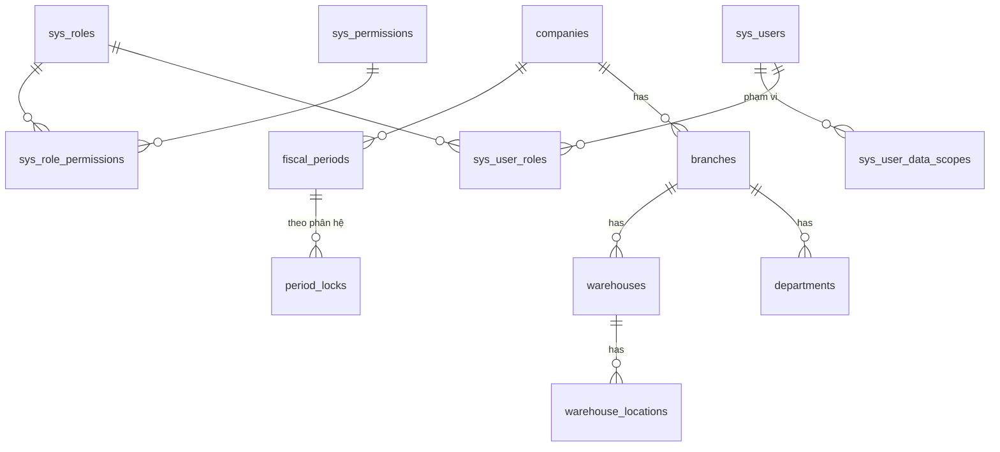
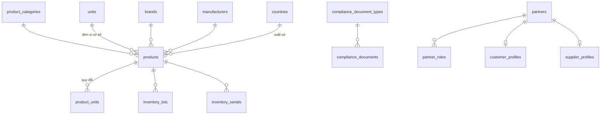
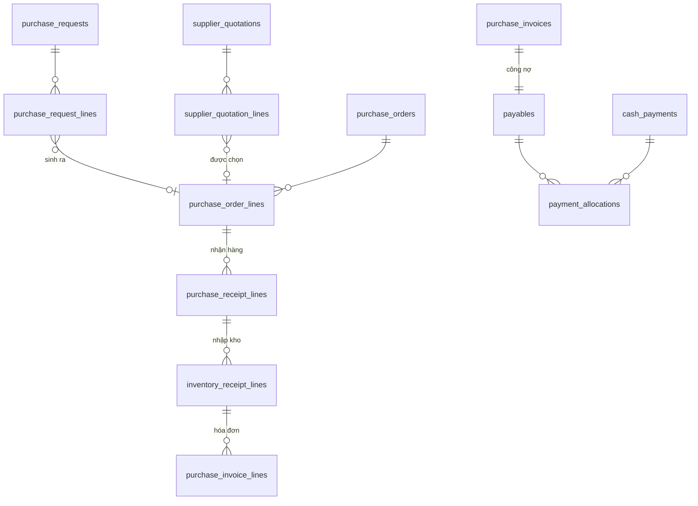
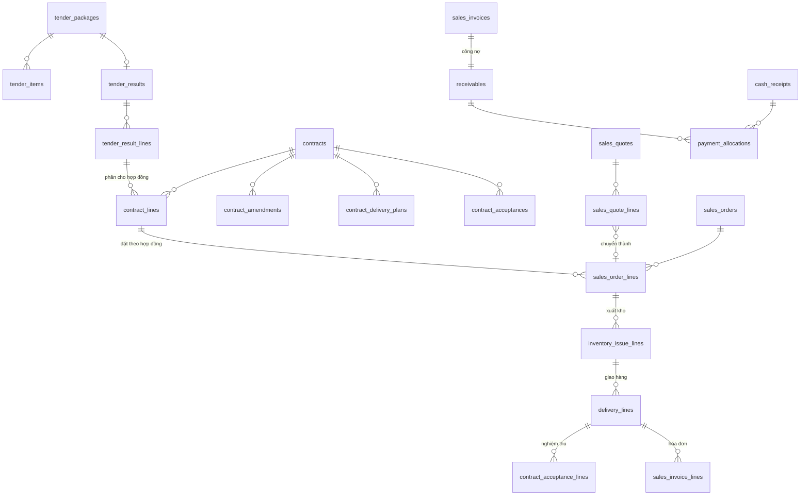
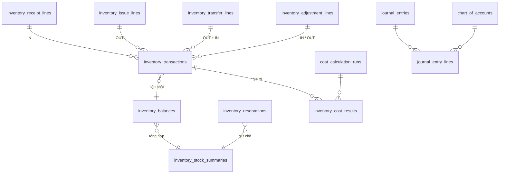

# Thiết kế cơ sở dữ liệu - ERD và data dictionary

| Thuộc tính | Giá trị |
|---|---|
| Phiên bản | 0.2 (DRAFT - phải duyệt trước khi viết migration) |
| Ngày cập nhật | 2026-10-10 |
| Database | MySQL 8.x, InnoDB, `utf8mb4_0900_ai_ci` |
| Căn cứ | `docs/01-business-requirements.md` v0.6, `.claude/rules/database.md` |

Tài liệu này là **mô hình logic**. Cột chi tiết của từng bảng được chốt khi thiết kế module tương ứng và phải cập nhật tại đây cùng lúc với migration Flyway.

**Migration đã có:**

| Phiên bản | File | Bảng |
|---|---|---|
| V1 | `backend/src/main/resources/db/migration/V1__create_common_tables.sql` | `document_sequences`, `sys_idempotency_keys`, `sys_audit_logs` (đúng mục 4.13–4.15). Chưa có FK `company_id`/`branch_id`; đã thêm ở V2 |
| V2 | `.../V2__create_organization_and_security.sql` | `companies`, `branches`, `departments`, `sys_users`, `sys_roles`, `sys_permissions`, `sys_user_roles`, `sys_role_permissions`, `sys_user_data_scopes`, `sys_refresh_tokens`, `sys_login_logs`; FK cho bảng V1; danh mục quyền M01 và 17 vai trò mặc định (mục 4.17) |
| V3 | `.../V3__create_periods_parameters_numbering.sql` | `fiscal_periods`, `period_locks`, `sys_parameter_definitions`, `sys_parameters`, `document_number_formats` (mục 4.18–4.20); 3 tham số D-05; 7 quyền mới và gán quyền mặc định (docs/07 mục 3) |

Dữ liệu mẫu dev/test: `db/dev-data/R__dev_organization_and_users.sql` (1 công ty, 2 chi nhánh, 3 phòng ban, 6 người dùng, 12 kỳ tháng năm 2026; docs/07 mục 5).

## 1. Quy ước

### 1.1 Đặt tên
- Bảng snake_case số nhiều; dòng chứng từ `<chứng_từ>_lines`; bảng hệ thống tiền tố `sys_`.
- PK `id BIGINT AUTO_INCREMENT`; FK `<thực_thể>_id`.
- Index `idx_<bảng>_<cột>`, unique `uk_<bảng>_<cột>`, FK `fk_<bảng>_<bảng_tham_chiếu>`.

### 1.2 Kiểu dữ liệu
| Dữ liệu | Kiểu |
|---|---|
| Tiền | `DECIMAL(19,4)`; hiển thị làm tròn đến đồng (D-05) |
| Đơn giá | `DECIMAL(19,4)` |
| Số lượng | `DECIMAL(19,3)` (D-05) |
| Hệ số quy đổi, tỷ giá | `DECIMAL(19,6)` |
| Ngày chứng từ, ngày hạch toán, hạn dùng | `DATE` |
| Thời điểm | `DATETIME(3)` UTC |
| Trạng thái, loại | `VARCHAR(30)` ánh xạ enum |

### 1.3 Nhóm cột chuẩn
| Nhóm | Cột | Áp dụng |
|---|---|---|
| Audit | `created_by, created_at, updated_by, updated_at` | Danh mục, chứng từ |
| Khóa lạc quan | `version INT NOT NULL DEFAULT 0` | Danh mục, chứng từ, bảng có sửa đồng thời |
| Tổ chức | `company_id, branch_id` | Chứng từ, dữ liệu có phạm vi |
| Chứng từ | `document_no, document_date, posting_date, status, description` | Mọi chứng từ |
| Quy trình | `submitted_by/at, approved_by/at, posted_by/at, reversed_by/at, reversal_of_id, cancel_reason` | Chứng từ nhóm A |
| Nguồn | `source_type, source_id, source_line_id` | Dòng chứng từ sinh từ chứng từ khác |
| Phân tích | `department_id, sales_staff_id, contract_id, tender_package_id, cost_item_id, statistic_code` | Chứng từ, dòng chứng từ (BR-GEN-61) |
| Danh mục | `code, name, status (ACTIVE/INACTIVE)` | Danh mục |

### 1.4 Sổ phụ bất biến
Các bảng sau **chỉ INSERT** (không UPDATE/DELETE qua ứng dụng):
- `inventory_transactions`
- `debt_ledger_entries`
- `cash_ledger_entries`
- `journal_entry_lines` (sau khi bút toán ghi sổ)
- `sys_audit_logs`
- `sys_login_logs`

Bảng số dư là bản đọc nhanh, tái tạo được từ sổ phụ:
- `inventory_balances`
- `inventory_stock_summaries`
- `receivables.remaining_amount`, `payables.remaining_amount`
- `cash_accounts.balance`

## 2. Danh sách bảng theo module

### M01 - `system`
| Bảng | Mục đích |
|---|---|
| `companies`, `branches`, `departments` | Cơ cấu tổ chức |
| `sys_users`, `sys_roles`, `sys_permissions`, `sys_user_roles`, `sys_role_permissions` | RBAC |
| `sys_user_data_scopes` | Phạm vi dữ liệu: công ty / chi nhánh / kho / "chỉ dữ liệu của mình" |
| `sys_refresh_tokens` | Refresh token (băm), thu hồi phiên |
| `sys_parameter_definitions`, `sys_parameters` | Định nghĩa tham số; giá trị tham số theo công ty |
| `document_number_formats` | Cấu hình số chứng từ theo công ty × loại, có ngày hiệu lực |
| `document_sequences` | Bộ đếm số chứng từ theo (công ty, chi nhánh, loại, kỳ `YYYY`/`YYYYMM`) |
| `approval_workflows`, `approval_workflow_steps` | Cấu hình ma trận duyệt |
| `approval_requests`, `approval_history` | Yêu cầu duyệt và lịch sử |
| `fiscal_periods`, `period_locks` | Kỳ tháng; khóa theo chi nhánh × phân hệ (INVENTORY, DEBT, CASH, ACCOUNTING) |
| `sys_audit_logs`, `sys_login_logs` | Nhật ký thao tác, đăng nhập |
| `sys_idempotency_keys` | Chống xử lý trùng |
| `notifications` | Thông báo trong ứng dụng |
| `attachments` | File đính kèm (owner_type, owner_id) |

### M02 - `masterdata`
| Bảng | Mục đích |
|---|---|
| `product_categories` | Nhóm hàng dạng cây (`parent_id`) |
| `products` | Hàng hóa; loại hàng, cờ lô/hạn/serial, thông tin pháp lý, bảo quản, bảo hành, định mức |
| `units`, `product_units` | Đơn vị tính; đơn vị giao dịch + hệ số quy đổi + hiệu lực |
| `brands`, `manufacturers`, `countries` | Nhãn hiệu, nhà sản xuất, xuất xứ |
| `partners`, `partner_roles` | Đối tượng và vai trò (CUSTOMER, SUPPLIER, AGENT, TENDER_OWNER, EMPLOYEE, OTHER) |
| `customer_profiles`, `supplier_profiles` | Thuộc tính riêng: hạn mức, số ngày nợ, bảng giá, hạn dùng tối thiểu / điều khoản, tiền tệ |
| `partner_contacts`, `partner_addresses` | Người liên hệ, địa chỉ giao |
| `warehouses`, `warehouse_locations` | Kho (thuộc chi nhánh, có loại kho ảo), vị trí (mỗi kho có vị trí mặc định) |
| `tax_rates` | Thuế suất và hiệu lực |
| `price_lists`, `price_list_items` | Bảng giá theo nhóm khách/khách/đại lý, hiệu lực, đơn vị, bậc số lượng |
| `currencies`, `exchange_rates` | Tiền tệ, tỷ giá theo ngày |
| `payment_terms`, `payment_methods`, `delivery_methods`, `contract_types`, `reasons`, `cost_items` | Danh mục phụ |
| `compliance_document_types` | Loại hồ sơ/giấy phép (số lưu hành, CO, CQ, ủy quyền...), có hạn hay không |
| `compliance_documents` | Hồ sơ cụ thể gắn với hàng / lô / serial / đối tác / công ty; số, ngày cấp, ngày hết hạn |

### M03 - `purchasing`
| Bảng | Mục đích |
|---|---|
| `purchase_requests`, `purchase_request_lines` | Đề nghị mua |
| `supplier_quotation_requests`, `supplier_quotation_request_suppliers` | Yêu cầu báo giá gửi nhiều NCC |
| `supplier_quotations`, `supplier_quotation_lines` | Báo giá NCC trả về; dòng được chọn |
| `purchase_orders`, `purchase_order_lines` | Đơn mua; dòng có chỉ tiêu đã nhận / đã nhập / lỗi / đã nhận HĐ / đã đóng |
| `purchase_receipts`, `purchase_receipt_lines` | **Phiếu nhận hàng**: thực nhận, lỗi, lý do |
| `purchase_invoices`, `purchase_invoice_lines` | Hóa đơn mua; dòng tham chiếu dòng phiếu nhập kho |
| `purchase_returns`, `purchase_return_lines` | Trả hàng NCC, giảm giá hàng mua |
| `landed_cost_vouchers`, `landed_cost_allocations` | Chi phí mua hàng và phân bổ vào dòng nhập kho |

### M04 - `inventory`
| Bảng | Mục đích |
|---|---|
| `inventory_lots` | Lô: (product, lot_no) duy nhất, hạn dùng, ngày sản xuất, trạng thái chất lượng mặc định |
| `inventory_serials` | Serial: (product, serial_no) duy nhất, vị trí hiện tại, trạng thái vòng đời |
| `inventory_documents`, `inventory_document_lines`, `inventory_document_line_serials` | **Chứng từ kho** (V6, ADR-10): `document_type` = PNK nhập, PXK xuất nội bộ, PXH xuất hủy, PCK chuyển kho, PDC điều chỉnh (kể cả từ kiểm kê, `sub_type = COUNT`), PCL chuyển trạng thái chất lượng, PDK chứng từ đảo. Phiếu nhập / xuất của mua, bán (Giai đoạn 5, 6) dùng cùng bảng với loại mới |
| `inventory_warehouse_states` | Trạng thái kho: phiếu kiểm kê đang chặn nhập xuất (D-11) |
| `stock_counts`, `stock_count_lines` | Kiểm kê (snapshot + số đếm) |
| `recalls` | Thu hồi lô / serial; danh sách khách và tiến độ tính từ sổ kho (không lưu bảng riêng) |
| `inventory_transactions` | **Sổ nhật ký kho** (bất biến) |
| `inventory_balances` | Tồn thực tế chi tiết theo vị trí/lô/serial/trạng thái |
| `inventory_stock_summaries` | Tổng theo (hàng, kho): tồn thực tế, khả dụng, giữ chỗ, đang về |
| `inventory_reservations` | Giữ chỗ theo đơn bán / hợp đồng / phiếu xuất chưa ghi sổ |
| `stock_issue_policies` | Chính sách xuất vượt tồn khả dụng được duyệt (D-40) |

### M05 - `sales`
| Bảng | Mục đích |
|---|---|
| `sales_quotes`, `sales_quote_lines` | Báo giá (có `revision_no`) |
| `sales_orders`, `sales_order_lines` | Đơn bán; dòng có chỉ tiêu đã xuất / đã giao / đã xuất HĐ / đã trả / còn lại |
| `payment_schedules` | Lịch thu tiền theo đơn hoặc hợp đồng |
| `deliveries`, `delivery_lines` | Giao hàng: trạng thái, ngày khách nhận, người nhận, biên bản |
| `sales_invoices`, `sales_invoice_lines` | Hóa đơn bán; số/ký hiệu/mã CQT (P1 nhập tay từ MISA) |
| `sales_returns`, `sales_return_lines` | Trả hàng, đổi hàng (liên kết phiếu xuất mới), giảm giá |
| `promotions`, `promotion_rules` | Chính sách chiết khấu, khuyến mại |

### M06 - `tender`
| Bảng | Mục đích |
|---|---|
| `tender_packages` | Gói thầu; bên mời thầu (`partner_id`), hạn nộp, trạng thái |
| `tender_bid_documents` | Danh mục hồ sơ dự thầu, người phụ trách, hạn, trạng thái |
| `tender_items` | Hàng dự thầu: hàng, model, hãng, xuất xứ, số lượng, giá dự thầu |
| `tender_results`, `tender_result_lines` | Kết quả trúng thầu: số QĐ, số lượng trúng, giá trúng, hiệu lực |
| `contracts`, `contract_lines` | Hợp đồng; dòng có chỉ tiêu trúng/tối đa, đã đặt, đã giao, đã nghiệm thu, đã xuất HĐ, đã thu |
| `contract_amendments`, `contract_amendment_lines` | Phụ lục (phiên bản, hiệu lực) |
| `contract_delivery_plans`, `contract_delivery_plan_lines` | Kế hoạch giao theo đợt |
| `contract_acceptances`, `contract_acceptance_lines` | Nghiệm thu theo đợt |
| `contract_document_checklists` | Hồ sơ giao hàng, nghiệm thu, thanh toán theo đợt |
| `guarantees` | Bảo lãnh dự thầu / thực hiện (P2) |

### M07 - `finance`
| Bảng | Mục đích |
|---|---|
| `receivables` | Khoản phải thu theo hóa đơn: số gốc, đã thu, còn lại, hạn |
| `payables` | Khoản phải trả theo hóa đơn |
| `debt_ledger_entries` | **Sổ chi tiết công nợ** (bất biến) |
| `cash_accounts` | Quỹ tiền mặt, tài khoản ngân hàng |
| `cash_receipts`, `cash_receipt_lines` | Phiếu thu, giấy báo có |
| `cash_payments`, `cash_payment_lines` | Phiếu chi, ủy nhiệm chi |
| `cash_transfers` | Chuyển tiền nội bộ |
| `payment_allocations` | Phân bổ thanh toán vào hóa đơn |
| `cash_ledger_entries` | **Sổ quỹ / sổ tiền gửi** (bất biến) |
| `debt_adjustments` | Điều chỉnh công nợ khi đối chiếu, có duyệt |
| `employee_advances` | Tạm ứng, hoàn ứng |

### M08 - `accounting`
| Bảng | Mục đích |
|---|---|
| `chart_of_accounts` | Hệ thống tài khoản (cây) |
| `posting_rules` | Quy tắc hạch toán theo loại chứng từ, loại hàng, loại đối tượng |
| `journal_entries`, `journal_entry_lines` | Bút toán (tự sinh từ chứng từ hoặc tổng hợp) |
| `cost_calculation_runs` | Lần tính giá vốn theo kỳ, kho |
| `inventory_cost_results` | Giá trị xuất theo từng dòng `inventory_transactions` của lần tính có hiệu lực |

### M09 - `equipment`
| Bảng | Mục đích |
|---|---|
| `equipment_records` | Hồ sơ thiết bị theo serial: khách, khoa phòng, hình thức sở hữu, hợp đồng |
| `warranties` | Bảo hành: bắt đầu, kết thúc, điều kiện |
| `equipment_handovers` | Bàn giao / lắp đặt, biên bản |
| `equipment_exchanges` | Đổi thiết bị: serial cũ ↔ mới |
| `service_tickets`, `service_ticket_parts` | Sửa chữa, linh kiện thay (P2) |

### M10 - `reporting`
Không sở hữu bảng nghiệp vụ. Có thể có bảng tổng hợp phục vụ hiệu năng (`report_snapshots`) nếu cần, luôn tái tạo được từ sổ phụ.

## 3. ERD

### 3.1 Tổ chức và phân quyền

### 3.2 Danh mục hàng hóa

### 3.3 Chuỗi mua hàng

### 3.4 Chuỗi bán hàng và đấu thầu

### 3.5 Kho và kế toán

## 4. Data dictionary - bảng lõi
Các bảng còn lại được chi tiết hóa khi thiết kế module.

### 4.1 `inventory_lots`
| Cột | Kiểu | Ràng buộc | Mô tả |
|---|---|---|---|
| id | BIGINT | PK | |
| product_id | BIGINT | FK, NOT NULL | Hàng |
| lot_no | VARCHAR(50) | NOT NULL | Số lô |
| manufacture_date | DATE | | Ngày sản xuất |
| expiry_date | DATE | | Hạn dùng (ngày cuối tháng nếu chỉ có tháng, D-06) |
| is_temporary | BOOLEAN | NOT NULL | Lô tạm khi chuyển đổi (D-13) |
| audit, version | | | |

Unique `uk_inventory_lots_product_lot (product_id, lot_no)`. Index `(expiry_date)`.

### 4.2 `inventory_serials`
| Cột | Kiểu | Ràng buộc | Mô tả |
|---|---|---|---|
| id | BIGINT | PK | |
| product_id | BIGINT | FK, NOT NULL | |
| serial_no | VARCHAR(100) | NOT NULL | |
| lot_id | BIGINT | FK | Lô (nếu có) |
| lifecycle_status | VARCHAR(30) | NOT NULL | IN_STOCK, ISSUED, AT_CUSTOMER, IN_REPAIR, RETURNED, SCRAPPED |
| current_warehouse_id | BIGINT | FK | Vị trí hiện tại (bản đọc nhanh) |
| audit, version | | | |

Unique `(product_id, serial_no)`.

### 4.3 `inventory_transactions` (sổ nhật ký kho, bất biến)
| Cột | Kiểu | Ràng buộc | Mô tả |
|---|---|---|---|
| id | BIGINT | PK | |
| company_id, branch_id | BIGINT | FK, NOT NULL | |
| posting_date | DATE | NOT NULL | Ngày hạch toán (quyết định kỳ) |
| posted_at | DATETIME(3) | NOT NULL | Thời điểm ghi sổ (UTC) |
| product_id | BIGINT | FK, NOT NULL | |
| warehouse_id, location_id | BIGINT | FK, NOT NULL | |
| lot_id, serial_id | BIGINT | FK | |
| quality_status | VARCHAR(30) | NOT NULL | |
| transaction_type | VARCHAR(30) | NOT NULL | OPENING, PURCHASE_RECEIPT, SALES_ISSUE, SALES_RETURN, PURCHASE_RETURN, TRANSFER_OUT, TRANSFER_IN, COUNT_GAIN, COUNT_LOSS, ADJUST_IN, ADJUST_OUT, STATUS_OUT, STATUS_IN, INTERNAL_ISSUE, SCRAP, REVERSAL... |
| direction | VARCHAR(3) | NOT NULL | IN / OUT |
| quantity | DECIMAL(19,3) | NOT NULL, > 0 | Theo đơn vị cơ sở |
| unit_cost, amount | DECIMAL(19,4) | | Giá nhập (với IN); giá xuất lấy từ `inventory_cost_results` |
| reference_type, reference_id, reference_line_id | | NOT NULL | Chứng từ và dòng nguồn |
| reference_no | VARCHAR(50) | NOT NULL | Số chứng từ |
| reversal_of_id | BIGINT | FK self | Dòng gốc bị đảo |
| created_by, created_at | | | |

Index: `(product_id, warehouse_id, posting_date)`, `(reference_type, reference_id)`, `(lot_id)`, `(serial_id)`, `(company_id, posting_date)`.

### 4.4 `inventory_balances` (tồn thực tế chi tiết)
| Cột | Kiểu | Ràng buộc | Mô tả |
|---|---|---|---|
| id | BIGINT | PK | |
| product_id, warehouse_id, location_id | BIGINT | NOT NULL | |
| lot_id, serial_id | BIGINT | NULL | |
| lot_key, serial_key | BIGINT | Cột sinh `IFNULL(lot_id,0)`, `IFNULL(serial_id,0)` (STORED) | Để unique hoạt động khi NULL |
| quality_status | VARCHAR(30) | NOT NULL | |
| on_hand_quantity | DECIMAL(19,3) | NOT NULL, CHECK ≥ 0 | |
| version | INT | | |
| updated_at | DATETIME(3) | | |

Unique `(product_id, warehouse_id, location_id, lot_key, serial_key, quality_status)`. Khóa `FOR UPDATE` khi ghi sổ.

### 4.5 `inventory_stock_summaries` (tổng theo hàng, kho)
| Cột | Kiểu | Mô tả |
|---|---|---|
| product_id, warehouse_id | BIGINT, unique | |
| on_hand_quantity | DECIMAL(19,3) | Tổng tồn thực tế |
| sellable_quantity | DECIMAL(19,3) | Tồn ĐẠT, chưa hết hạn |
| reserved_quantity | DECIMAL(19,3) | Tổng giữ chỗ còn hiệu lực |
| incoming_quantity | DECIMAL(19,3) | Hàng đang về |
| version, updated_at | | |

Tồn khả dụng = `sellable_quantity − reserved_quantity` (tính, không lưu). Hàng hết hạn chuyển khỏi `sellable_quantity` bằng job hằng ngày (idempotent) và bằng kiểm tra trực tiếp khi xuất. **Thứ tự khóa khi ghi sổ:** dòng summary trước, rồi các dòng balance theo thứ tự khóa tăng dần.

### 4.6 `inventory_reservations`
| Cột | Kiểu | Mô tả |
|---|---|---|
| id | BIGINT | |
| product_id, warehouse_id | BIGINT | |
| lot_id, serial_id | BIGINT NULL | Giữ chỗ chỉ định lô/serial (tùy chọn) |
| source_type, source_id, source_line_id | | Đơn bán / hợp đồng / phiếu xuất |
| quantity, consumed_quantity, released_quantity | DECIMAL(19,3) | |
| status | VARCHAR(30) | ACTIVE, CONSUMED, RELEASED, EXPIRED |
| expires_at | DATETIME(3) | Mặc định 7 ngày (D-37, tham số) |

### 4.7 `contract_lines`
| Cột | Kiểu | Mô tả |
|---|---|---|
| id, contract_id, product_id, unit_id | | |
| tender_result_line_id | BIGINT NULL | Dòng kết quả trúng thầu |
| unit_price | DECIMAL(19,4) | Giá cố định theo hợp đồng / phụ lục hiệu lực |
| max_quantity | DECIMAL(19,3) | Số lượng tối đa |
| ordered_quantity, delivered_quantity, accepted_quantity, invoiced_quantity | DECIMAL(19,3) | Chỉ tiêu cập nhật trong transaction của chứng từ đích |
| paid_amount | DECIMAL(19,4) | |
| version | INT | |

CHECK `delivered_quantity ≤ max_quantity`. Khóa `FOR UPDATE` khi xuất/giao theo hợp đồng (AT-07).

### 4.8 `receivables` / `payables`
| Cột | Kiểu | Mô tả |
|---|---|---|
| id, company_id, branch_id, partner_id | | |
| invoice_type, invoice_id | | Hóa đơn bán / mua (unique) |
| invoice_date, due_date | DATE | |
| original_amount, settled_amount, remaining_amount | DECIMAL(19,4) | `remaining = original − settled`, CHECK ≥ 0 |
| contract_id, sales_staff_id | BIGINT NULL | |
| status | VARCHAR(30) | OPEN, PARTIAL, SETTLED, REVERSED |
| version | INT | |

Index `(partner_id, due_date)`, `(status, due_date)`.

### 4.9 `debt_ledger_entries` (bất biến)
`id, company_id, branch_id, partner_id, debt_type (AR/AP), posting_date, entry_type (INVOICE, RECEIPT, PAYMENT, RETURN, DISCOUNT, OFFSET, ADJUSTMENT, REVERSAL), debit_amount, credit_amount, receivable_id / payable_id, reference_type, reference_id, reference_no, reversal_of_id, created_by, created_at`.

### 4.10 `payment_allocations`
`id, payment_type (RECEIPT/PAYMENT), payment_id, receivable_id / payable_id, allocated_amount, discount_amount, posting_date, status (ACTIVE/REVERSED), reversal_of_id, created_by, created_at`.

### 4.11 `journal_entries`, `journal_entry_lines`
- `journal_entries`: `id, company_id, branch_id, entry_no, posting_date, source_type, source_id, source_no, entry_kind (AUTO/MANUAL/COST/CLOSING), status, reversal_of_id, audit`.
- `journal_entry_lines`: `id, journal_entry_id, account_id, debit_amount, credit_amount, partner_id, product_id, warehouse_id`, các cột phân tích.
- Ràng buộc nghiệp vụ: Σ Nợ = Σ Có (kiểm tra ở service + test).

### 4.12 `inventory_cost_results`
`id, cost_calculation_run_id, inventory_transaction_id, unit_cost, amount, is_effective`. Mỗi `inventory_transaction_id` chỉ có một kết quả `is_effective = true` (unique theo cột sinh). Kết quả của kỳ đã khóa không bị thay thế (BR-CST-03).

### 4.13 `document_sequences`
`company_id, branch_id, document_type, period_key (YYYY hoặc YYYYMM theo chu kỳ đặt lại), next_value, version`. Unique `(company_id, branch_id, document_type, period_key)`; lấy số bằng `SELECT ... FOR UPDATE` trong transaction tạo/ghi sổ.

### 4.14 `sys_idempotency_keys`
`id, user_id, idempotency_key, request_hash, endpoint, response_status, response_body (JSON), created_at, expires_at`. Unique `(user_id, idempotency_key)`.

### 4.15 `sys_audit_logs`
`id, occurred_at, actor_user_id, action, entity_type, entity_id, document_no, reason, before_value (JSON), after_value (JSON), request_id, ip_address, company_id, branch_id`. Index `(entity_type, entity_id)`, `(actor_user_id, occurred_at)`, `(occurred_at)`.

### 4.17 Tổ chức, người dùng, phân quyền (V2)
| Bảng | Cột chính | Ràng buộc |
|---|---|---|
| `companies` | `code, name, tax_code, address, phone, email, status` + cột audit, `version` | `uk_companies_code` |
| `branches` | `company_id, code, name, address, phone, status` + audit, `version` | `uk_branches_company_code (company_id, code)` |
| `departments` | `branch_id, code, name, status` + audit, `version` | `uk_departments_branch_code (branch_id, code)` |
| `sys_users` | `company_id, default_branch_id, username, full_name, email, phone, password_hash` (BCrypt), `status, own_data_only, must_change_password, failed_login_count, locked_until, credentials_changed_at` (phiên bản thông tin đăng nhập, mili-giây), `last_login_at` + audit, `version` | `uk_sys_users_username`. `failed_login_count, locked_until, last_login_at` chỉ cập nhật bằng câu lệnh riêng (không tăng `version`) |
| `sys_roles` | `code, name, description, system_role, status` + audit, `version` | `uk_sys_roles_code` |
| `sys_permissions` | `code, module, name, sort_order` | Dữ liệu tham chiếu do migration định nghĩa |
| `sys_user_roles`, `sys_role_permissions` | Bảng nối | PK kép |
| `sys_user_data_scopes` | `user_id, scope_type (COMPANY/BRANCH/WAREHOUSE), scope_id` | `uk (user_id, scope_type, scope_id)`; FK `scope_id` theo loại kiểm tra ở ứng dụng |
| `sys_refresh_tokens` | `user_id, family_id, token_hash` (SHA-256), `issued_at, session_expires_at, idle_expires_at, used_at, revoked_at, revoke_reason, created_ip, user_agent` | `uk token_hash`; idx `family_id`, `user_id` |
| `sys_login_logs` | `occurred_at, event, username, user_id, ip_address, user_agent, request_id` | Chỉ INSERT; idx `occurred_at`, `(user_id, occurred_at)` |

### 4.18 Kỳ và khóa kỳ (V3, BR-SYS-30..32)
| Bảng | Cột chính | Ràng buộc |
|---|---|---|
| `fiscal_periods` | `company_id, period_year, period_month, start_date, end_date` + audit, `version` | `uk (company_id, period_year, period_month)`; idx `(company_id, start_date, end_date)`. Năm tài chính = năm dương lịch `[Suy luận]` |
| `period_locks` | `fiscal_period_id, branch_id, module (INVENTORY/DEBT/CASH/ACCOUNTING), locked, changed_by, changed_at, reason` + audit, `version` | `uk (fiscal_period_id, branch_id, module)`. Không có dòng hoặc `locked = FALSE`: kỳ đang mở. Dòng được tạo trước trong transaction riêng khi khóa/mở để khóa dòng không rơi vào khoảng trống (tránh deadlock). Lịch sử khóa/mở: `sys_audit_logs` (`LOCK_PERIOD`, `UNLOCK_PERIOD`) |

### 4.19 Tham số hệ thống (V3, BR-SYS-13)
| Bảng | Cột chính | Ràng buộc |
|---|---|---|
| `sys_parameter_definitions` | `param_key` (PK), `module, name, description, value_type (INTEGER/DECIMAL/BOOLEAN/STRING/ENUM), default_value, min_value, max_value, allowed_values, lock_after_posting, sort_order` | Dữ liệu tham chiếu, chỉ thêm bằng migration |
| `sys_parameters` | `company_id, param_key, param_value` + audit, `version` | `uk (company_id, param_key)`; FK tới định nghĩa. Không có dòng = dùng giá trị mặc định |

Tham số đã có: `decimal.quantity-scale` (3), `decimal.unit-price-scale` (4), `decimal.amount-scale` (0) theo D-05. Giới hạn trên bằng số lẻ của kiểu cột. Chưa module nào đọc; module ghi sổ dùng khi triển khai.

### 4.20 `document_number_formats` (V3, BR-SYS-10)
`company_id, document_type, prefix, sequence_length (3–10), reset_cycle (YEARLY/MONTHLY), effective_from` + audit, `version`. Unique `(company_id, document_type, effective_from)`.
- Định dạng số: `<prefix>-<mã chi nhánh>-<YYYY|YYYYMM>-<số thứ tự>`. Chi nhánh và kỳ luôn được in vì bộ đếm tách theo chi nhánh và kỳ, nên số không trùng giữa chi nhánh và chu kỳ.
- Loại chưa có cấu hình: định dạng D-03 (mã loại làm tiền tố, 6 số, theo năm).
- Loại chưa cấp số: cấu hình có hiệu lực ngay (`effective_from = 2000-01-01`). Đã cấp số: hiệu lực từ đầu tháng sau (theo tháng → theo tháng) hoặc đầu năm sau (các trường hợp khác), nên một năm không có cả bộ đếm theo năm và theo tháng.
- Cấu hình đã có hiệu lực không sửa, không xóa; cấu hình đặt trước được sửa hoặc xóa.

### 4.16 Chứng từ kho: `inventory_documents`, `inventory_document_lines` (V6, thay mẫu `inventory_issues` dự kiến)
- `inventory_documents`: cột chuẩn chứng từ (`company_id, branch_id, document_no, document_date, posting_date, status`, người / thời điểm gửi, duyệt, ghi sổ, hủy, lý do) + `document_type`, `sub_type` (`RECALL_IN`, `COUNT`), `warehouse_id`, `destination_warehouse_id`, `transit_warehouse_id` (kho "đang vận chuyển" khi chuyển khác chi nhánh), `partner_id`, `reason_id`, `reason_text`, `recall_id`, `stock_count_id`, `issue_policy_id`, `reversal_of_id` / `reversed_by_id` (truy vết hai chiều chứng từ đảo), `received_by/at`, `receive_posting_date`, `total_amount`. Unique `(company_id, document_no)`.
- Trạng thái: `DRAFT, SUBMITTED, APPROVED, REJECTED, IN_TRANSIT` (chuyển khác chi nhánh đã xuất, chưa nhận), `POSTED, CANCELLED, REVERSED`.
- `inventory_document_lines`: `line_no, product_id, unit_id, conversion_factor, quantity, base_quantity, direction` (PDC), `location_id, destination_location_id, lot_id` hoặc `lot_no + manufacture_date + expiry_date` (lô mới khi nhập), `quality_status, target_quality_status` (PCL), `unit_cost, amount` (dòng nhập, D-51), `lot_override_reason` (chọn lô khác FEFO, BR-INV-21), `note`.
- `inventory_document_line_serials (line_id, serial_no)`: serial của dòng.

### 4.21 Phê duyệt và thông báo (V4, BR-SYS-11, BR-SYS-25)
- `sys_document_types (code PK, module, name, approval_mode NONE|CONFIGURED|REQUIRED, self_approval_allowed)` (D-52).
- `approval_workflows (company_id, document_type, branch_id, min_amount, min_discount_percent, priority, status)` + `approval_workflow_steps (workflow_id, step_no, approver_type ROLE|USER, role_id, user_id)`.
- `approval_requests`: chụp các bước của luồng lúc gửi; `pending_flag` (cột sinh) + unique `(document_type, document_id, pending_flag)` chặn hai yêu cầu đang chờ. `approval_request_steps`, `approval_actions` (bất biến: người, thời điểm, hành động, ý kiến, người được ủy quyền thay).
- `approval_delegations (delegator_user_id, delegate_user_id, document_type, valid_from, valid_to, status)`.
- `notifications (user_id, category, title, body, link_type, link_id, event_key, read_at)`; unique `(user_id, event_key)` để gửi lại không trùng.

### 4.22 Danh mục (V5, BR-MD-01..47)
- Mã danh mục duy nhất theo công ty: `units, brands, manufacturers, partner_groups, reference_items (category), tax_rates, product_categories (parent_id), products, warehouses, price_lists, compliance_document_types`; `countries (code PK)`.
- `products`: loại hàng, đơn vị cơ sở, cờ `lot_tracked / expiry_tracked / serial_tracked` (khóa khi đã phát sinh giao dịch kho, BR-MD-04), phân loại TTBYT, số đăng ký, điều kiện bảo quản. `product_units (product_id, unit_id, conversion_factor DECIMAL(19,6), effective_from)`; `product_stock_levels (product_id, warehouse_id, min_quantity, max_quantity)`.
- `warehouses (branch_id, warehouse_type NORMAL|VIRTUAL, virtual_kind IN_TRANSIT|AT_CUSTOMER|IN_REPAIR|DEMO)`; `warehouse_locations (warehouse_id, code, zone_type, default_flag)` - mỗi kho đúng một vị trí mặc định (cột sinh + unique).
- `partners` + `partner_roles, partner_contacts, partner_addresses`; `price_lists` + `price_list_items`; `compliance_documents (owner_type, owner_id, valid_to)`.

### 4.23 Kho bổ sung (V6, V7)
- `inventory_balances`: cột sinh `lot_key = COALESCE(lot_id, 0)`, `serial_key = COALESCE(serial_id, 0)` để unique `(product_id, warehouse_id, location_id, lot_key, serial_key, quality_status)` hoạt động khi lô / serial trống; `CHECK (on_hand_quantity >= 0)`.
- `inventory_transactions`: `transaction_type` (OPENING, RECALL_IN, INTERNAL_ISSUE, SCRAP, TRANSFER_OUT/IN, ADJUST_IN/OUT, COUNT_GAIN/LOSS, STATUS_OUT/IN, REVERSAL), `direction IN|OUT`, `quantity > 0`, `unit_cost` (nhập), `reference_type/id/line_id/no`, `reversal_of_id` (dòng sổ gốc khi đảo). Chỉ INSERT.
- `stock_counts (warehouse_id, count_date, status DRAFT|COUNTING|SUBMITTED|APPROVED|POSTED|CANCELLED, adjustment_document_id)` + `stock_count_lines (product, location, lot, serial, quality_status, snapshot_quantity, counted_quantity)`.
- `recalls (product_id, lot_id | serial_id, reason, status)`; `stock_issue_policies (warehouse_id, product_id, max_quantity, used_quantity, used_by_document_id, valid_from, valid_to, status)` (D-53; `used_by_document_id` thêm ở V8, FK `inventory_documents`: mỗi chính sách một chứng từ); `inventory_reservations (product, warehouse, source_type/id/line_id, quantity, consumed, released, status)`.
- V7: tham số `inventory.expiry-warning-days` (mặc định 90 `[Suy luận]`) cho cảnh báo hạn dùng.

## 5. Index chính
| Truy vấn | Index |
|---|---|
| Tìm hàng theo mã | `uk_products_company_code (company_id, code)` |
| Danh sách chứng từ theo trạng thái, ngày | `(company_id, branch_id, status, document_date)` mỗi bảng chứng từ |
| Số chứng từ | `uk_<bảng>_document_no (company_id, document_no)` |
| Thẻ kho | `inventory_transactions (product_id, warehouse_id, posting_date)` |
| Truy xuất lô/serial | `inventory_transactions (lot_id)`, `(serial_id)` |
| Hàng sắp hết hạn | `inventory_lots (expiry_date)` + `inventory_balances (lot_id)` |
| Chứng từ kho theo loại, trạng thái, ngày | `inventory_documents (company_id, document_type, status, document_date)` |
| Chứng từ phụ thuộc khi đảo | `inventory_transactions (warehouse_id, product_id, lot_id, serial_id, posted_at)` |
| Tuổi nợ | `receivables (partner_id, due_date)`, `(status, due_date)` |
| Hóa đơn mua trùng | `uk_purchase_invoices_seller (seller_tax_code, invoice_series, invoice_no)` |
| Tiến độ hợp đồng | `contract_lines (contract_id, product_id)` |

## 6. Dữ liệu mẫu
- Thư mục `db/dev-data`, chỉ bật ở profile `dev`, `test`. Không bao giờ ở `prod`.
- Gồm: 1 công ty, 2 chi nhánh, 3 kho (trong đó 1 kho ảo), người dùng mẫu cho mỗi vai trò, hàng mẫu cho từng loại hàng, lô gần hết hạn, serial, 1 gói thầu và hợp đồng mẫu.
- Mật khẩu người dùng mẫu chỉ cho môi trường dev, băm sẵn, không trùng mật khẩu thật.

## 7. Thuật ngữ
| Tiếng Việt | Tên trong mã / DB |
|---|---|
| Phiếu nhận hàng | purchase_receipt |
| Chứng từ kho (nhập, xuất, chuyển, điều chỉnh, đổi trạng thái, đảo) | inventory_document (document_type PNK, PXK, PXH, PCK, PDC, PCL, PDK) |
| Kiểm kê / thu hồi / chính sách xuất vượt tồn | stock_count / recall / stock_issue_policy |
| Giao hàng | delivery |
| Hóa đơn bán / mua | sales_invoice / purchase_invoice |
| Phiếu thu / chi | cash_receipt / cash_payment |
| Tồn thực tế / khả dụng / giữ chỗ / đang về | on_hand / available / reserved / incoming |
| Gói thầu / kết quả trúng thầu / hợp đồng | tender_package / tender_result / contract |
| Nghiệm thu | acceptance |
| Ghi sổ / đảo | post / reverse |
| Kỳ / khóa kỳ | fiscal_period / period_lock |

## 8. Vấn đề còn mở
- Cột chi tiết của bảng ngoài mục 4 chốt khi thiết kế module.
- Phương pháp giá vốn và quy tắc hạch toán đã chốt (D-02, D-34, D-35) nhưng kế toán trưởng rà soát trước UAT; vì vậy quy tắc nằm trong dữ liệu `posting_rules` (cấu hình), không trong schema.
- Lưu trữ (D-14): không xóa qua ứng dụng, lưu tối thiểu 10 năm; `sys_audit_logs`, `sys_login_logs` cần chiến lược partition/archive theo năm khi dữ liệu lớn.
