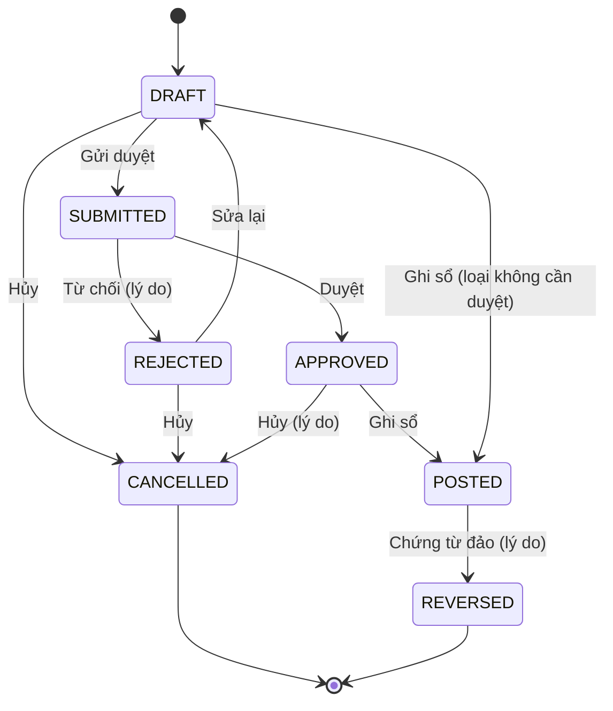
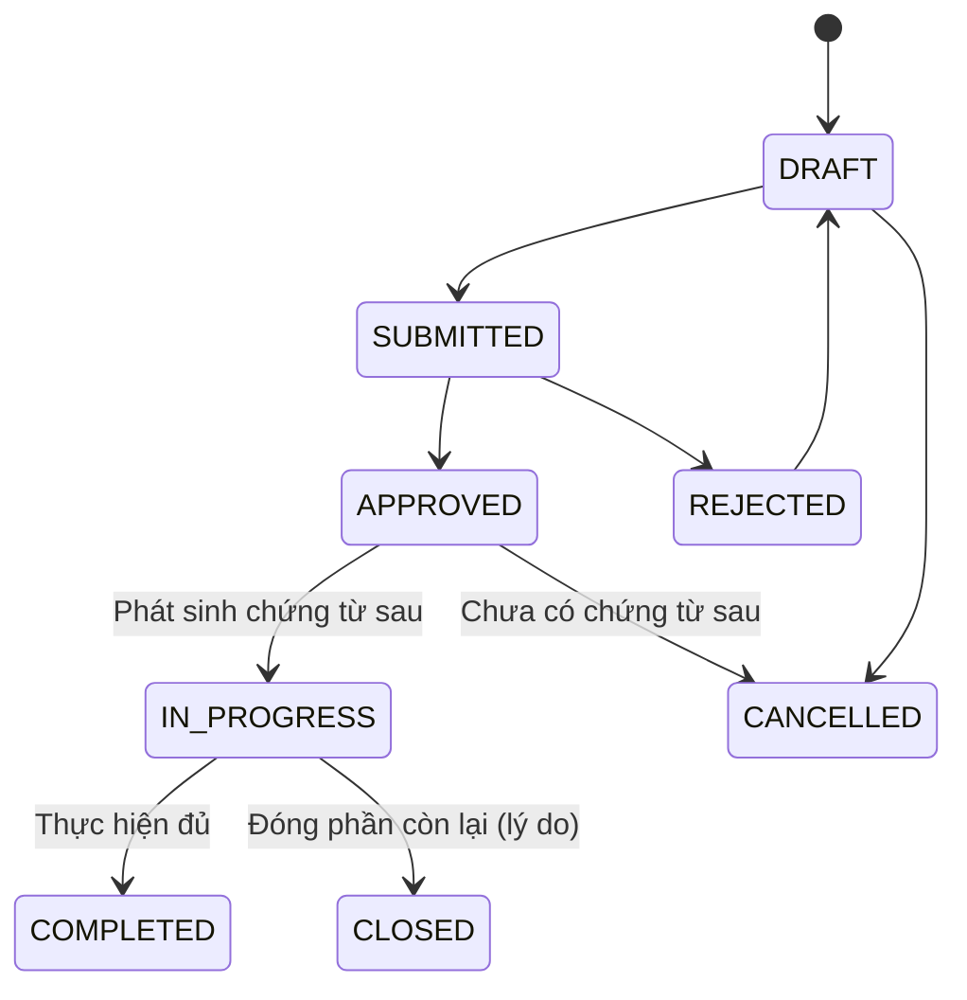
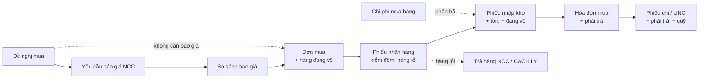
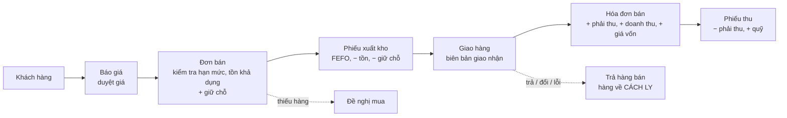
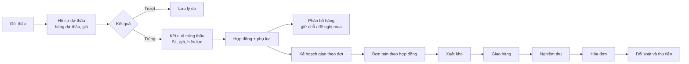
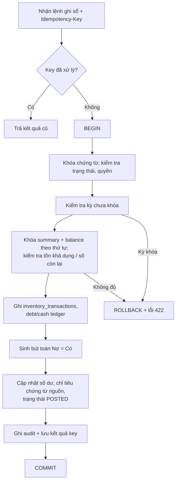
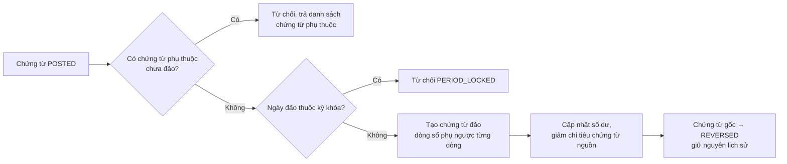
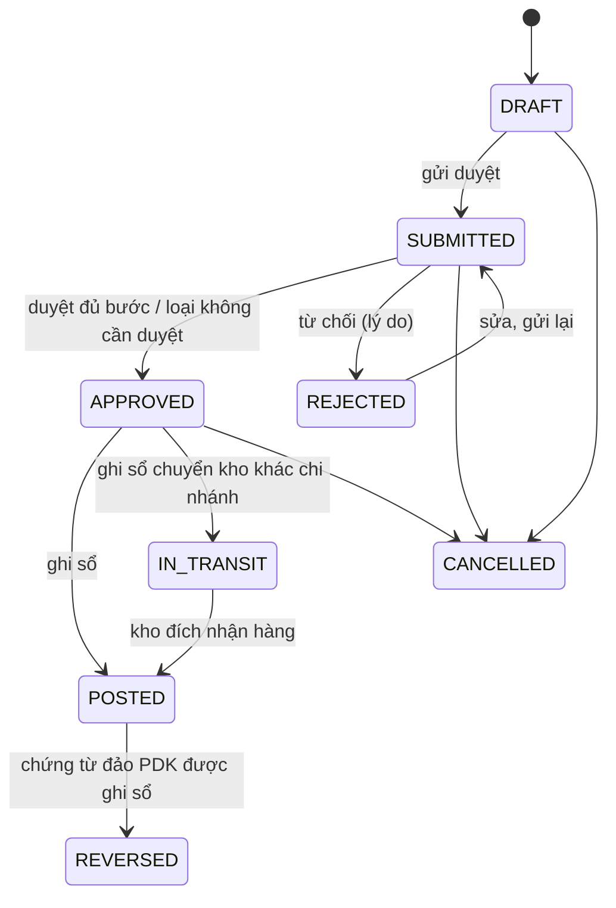
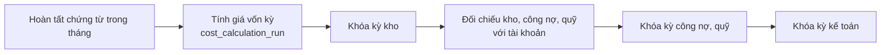

# Luồng nghiệp vụ

| Thuộc tính | Giá trị |
|---|---|
| Phiên bản | 0.2 (DRAFT) |
| Ngày cập nhật | 2026-10-09 |
| Căn cứ | `docs/01-business-requirements.md` v0.6 (mục 1, 5, 8–14) |

## 1. Vòng đời chứng từ

### 1.1 Nhóm A - chứng từ ghi sổ
Phiếu nhận hàng, phiếu nhập/xuất/chuyển kho, điều chỉnh, kiểm kê, hóa đơn mua/bán, phiếu thu/chi, nghiệm thu, bút toán tổng hợp.


### 1.2 Nhóm B - chứng từ điều phối
Đề nghị mua, yêu cầu báo giá, đơn mua, báo giá bán, đơn bán, giao hàng, gói thầu, hợp đồng.

Quy tắc: chỉ POSTED ảnh hưởng tồn thực tế và số liệu tài chính; nhóm B chỉ ảnh hưởng giữ chỗ, hàng đang về, số còn được giao (BR-GEN-02).

## 2. Chuỗi mua hàng

| Bước | Kiểm tra chính | Mã BR |
|---|---|---|
| Đơn mua duyệt | Ngưỡng duyệt; NCC có vai trò SUPPLIER | BR-PUR-04 |
| Nhận hàng | Không vượt số đặt quá dung sai; ghi số lỗi | BR-PUR-07 |
| Nhập kho | Lô/hạn/serial bắt buộc theo hàng; chặn hàng hết hạn; kỳ chưa khóa | BR-PUR-08, BR-INV-01..02, BR-INV-11 |
| Hóa đơn mua | Chống trùng; đối chiếu ba chiều; hóa đơn về sau thì điều chỉnh giá nhập | BR-PUR-09..11 |
| Thanh toán | Duyệt theo ngưỡng; quỹ không âm; phân bổ không vượt còn lại | BR-AP-02, BR-CSH-03 |

## 3. Chuỗi bán hàng

- Đơn bán, xuất kho, giao hàng, hóa đơn, thu tiền là các sự kiện riêng, có thể nhiều lần cho một đơn (BR-SAL-20).
- Doanh thu, phải thu, giá vốn ghi nhận khi hóa đơn bán ghi sổ (D-35; quy tắc cấu hình, kế toán trưởng rà soát trước UAT). Hàng đã xuất chưa có hóa đơn được theo dõi là hàng gửi đi bán.
- Thao tác nhanh (BR-SAL-42) sinh các chứng từ trên trong một lần, vẫn là chứng từ riêng và liên kết.

## 4. Chuỗi đấu thầu

Kiểm soát: mỗi lần đặt, xuất, giao theo hợp đồng khóa dòng hợp đồng và kiểm tra `đã giao + lần này ≤ số lượng tối đa` (BR-TND-22, AT-07).

## 5. Ghi sổ (trong một transaction)


## 6. Đảo chứng từ


Đã làm cho chứng từ kho (Giai đoạn 3): thao tác "Đảo" lập chứng từ đảo PDK và gửi duyệt ngay; kiểm tra chứng từ phụ thuộc và kỳ khóa diễn ra **khi ghi sổ PDK** (lúc đó mới khóa số dư). Hàng của chứng từ gốc đã bị chứng từ khác xuất thì ghi sổ PDK báo `HAS_DEPENDENT_DOCUMENTS` kèm số chứng từ cần đảo trước. Hủy PDK thì chứng từ gốc đảo lại được.

### 6.1 Chứng từ kho (Giai đoạn 3)

Chuyển kho khác chi nhánh: ghi sổ xuất khỏi kho nguồn và nhập vào kho "đang vận chuyển" của chi nhánh nguồn; người thuộc kho đích xác nhận nhận hàng thì xuất khỏi kho đang vận chuyển, nhập kho đích (đúng lô, serial, trạng thái).

## 7. Kiểm kê
```
DRAFT -> COUNTING (bắt đầu đếm: snapshot tồn theo vị trí/lô/serial/trạng thái; chặn ghi sổ nhập/xuất của kho)
      -> nhập số đếm (khi COUNTING; hàng tìm thấy ngoài sổ thêm dòng với tồn sổ sách 0)
      -> SUBMITTED (đủ số đếm) -> APPROVED -> POSTED (sinh phiếu điều chỉnh PDC loại COUNT theo chênh lệch, mở khóa kho)
SUBMITTED -> COUNTING khi bị từ chối (vẫn khóa kho); hủy ở bất kỳ bước chưa ghi sổ thì mở khóa kho
```

## 8. Khóa kỳ cuối tháng

Mở lại kỳ: Kế toán trưởng hoặc Giám đốc duyệt, có lý do, ghi audit (BR-SYS-32).

## 9. Phê duyệt
- Ma trận duyệt cấu hình theo loại chứng từ, chi nhánh, ngưỡng giá trị/chiết khấu, số cấp (BR-SYS-11, D-04).
- Duyệt bắt buộc: giá dưới giá sàn, vượt hạn mức tín dụng, hợp đồng, giá dự thầu dưới biên, phiếu chi trên ngưỡng, điều chỉnh tồn, hủy hàng, thu hồi, đảo chứng từ, xuất vượt tồn khả dụng.
- Người lập không tự duyệt khi bật tách biệt nhiệm vụ.
- Mỗi bước duyệt/từ chối ghi `approval_history` và audit.
