# Luồng nghiệp vụ

| Thuộc tính | Giá trị |
|---|---|
| Phiên bản | 0.2 (DRAFT) |
| Ngày cập nhật | 2026-10-09 |
| Căn cứ | `docs/01-business-requirements.md` v0.6 (mục 1, 5, 8–14) |

## 1. Vòng đời chứng từ

### 1.1 Nhóm A - chứng từ ghi sổ
Đơn mua, đơn bán (D-54), trả hàng / giảm giá mua bán, phân bổ chi phí mua, phiếu nhập/xuất/chuyển kho, điều chỉnh, kiểm kê, phiếu thu/chi, nghiệm thu, bút toán tổng hợp.
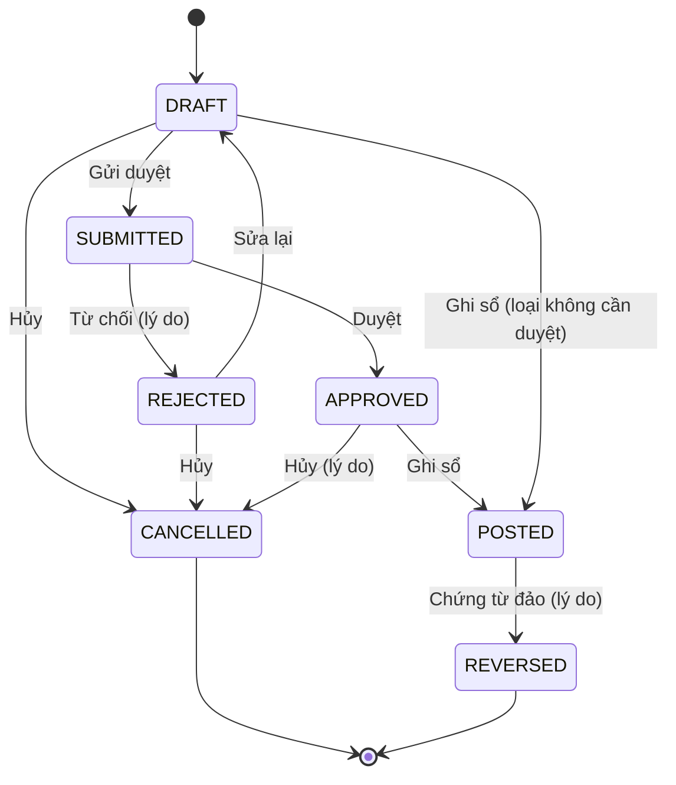

### 1.2 Nhóm B - chứng từ điều phối
Gói thầu, hợp đồng (từ D-54 đơn mua, đơn bán là chứng từ ghi sổ nhóm A).
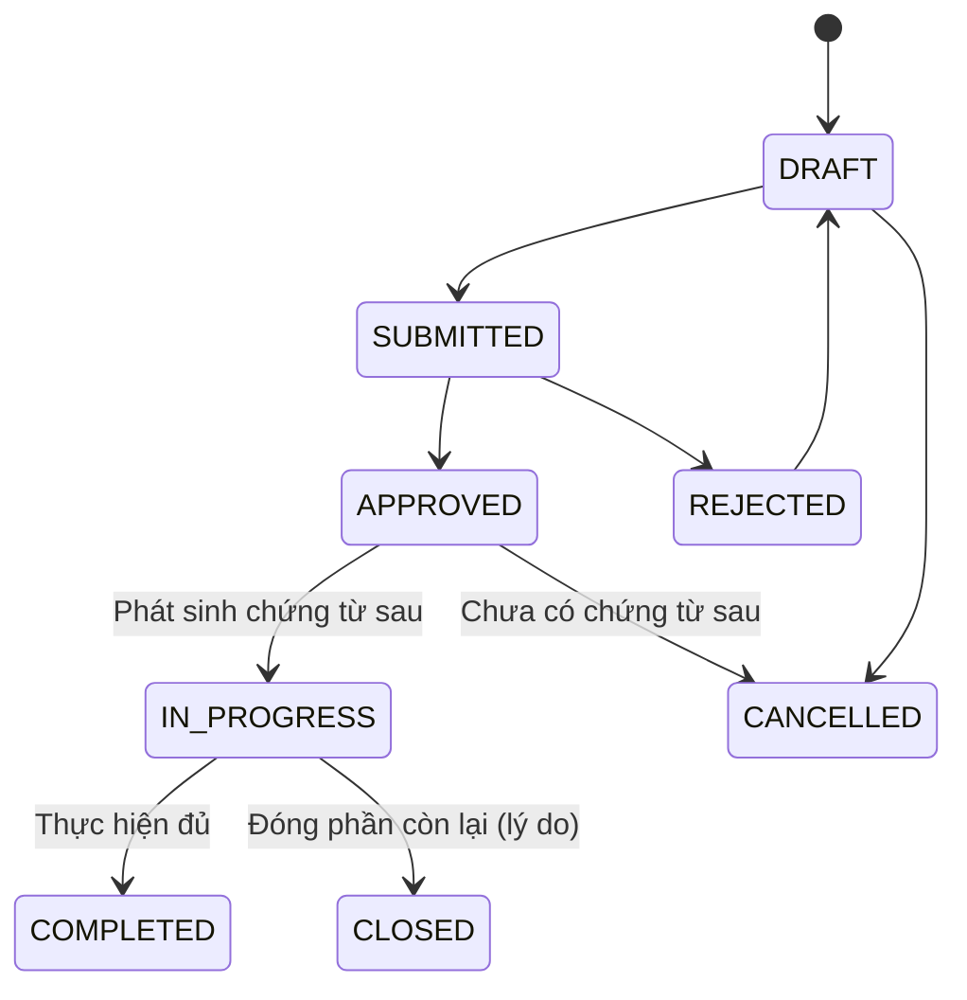
Quy tắc: chỉ POSTED ảnh hưởng tồn thực tế và số liệu tài chính; nhóm B chỉ ảnh hưởng giữ chỗ, hàng đang về, số còn được giao (BR-GEN-02).

## 2. Chuỗi mua hàng (D-54)
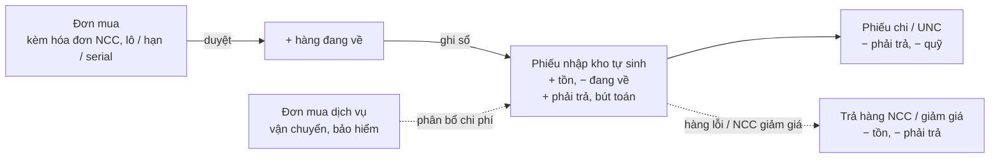
| Bước | Kiểm tra chính | Mã BR |
|---|---|---|
| Lập / gửi duyệt đơn mua | NCC có vai trò SUPPLIER; kho vật lý cùng chi nhánh; chỉ VND; lô / hạn dùng theo cấu hình hàng, số serial bằng số lượng cơ sở; hóa đơn NCC đủ ký hiệu, số, ngày hoặc để trống, không trùng (MST, ký hiệu, số). Tổng tiền từ ngưỡng `purchasing.order-approval-threshold` phải duyệt. Duyệt: + hàng đang về; hủy đơn đã duyệt: − hàng đang về | BR-PUR-04, 09 |
| Ghi sổ đơn mua | Đơn đã duyệt; kỳ chưa khóa. Lập phiếu nhập kho PNK nguồn `DMH` cho dòng hàng hóa (đơn giá sau chiết khấu), ghi sổ ngay; − hàng đang về; khoản công nợ phải trả (hạn = ngày hóa đơn / ngày hạch toán + số ngày nợ); bút toán theo quy tắc DMH | BR-PUR-08, 09, BR-INV-01..02, 11, D-34 |
| Đảo đơn mua | Chặn khi còn trả hàng / giảm giá / phân bổ chưa đảo, hàng đã xuất (đảo phiếu nhập bị chặn), đã thanh toán; đảo phiếu nhập, công nợ, bút toán; giải phóng số hóa đơn | BR-GEN-04, 21 |
| Trả hàng / giảm giá (5D) | Theo dòng đơn mua đã ghi sổ; trả không vượt số còn trả, đúng serial của dòng; giảm giá không vượt giá trị còn lại | BR-PUR-14 |
| Phân bổ chi phí (5D) | Nguồn: dòng dịch vụ của đơn mua đã ghi sổ; đích: dòng hàng hóa của đơn mua đã ghi sổ; theo giá trị hoặc số lượng | BR-PUR-12, 16 |
| Thanh toán | Duyệt theo ngưỡng; quỹ không âm; phân bổ không vượt còn lại | BR-AP-02, BR-CSH-03 |

## 3. Chuỗi bán hàng (D-54)
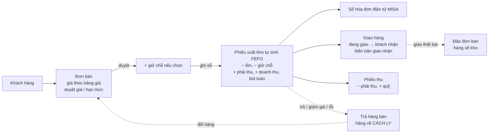
- Ghi sổ đơn bán làm cùng lúc xuất kho, doanh thu, công nợ phải thu, bút toán (D-54, D-35; quy tắc cấu hình, kế toán trưởng rà soát trước UAT). Mỗi lần giao là một đơn bán; giá vốn ở Giai đoạn 8.
- Lô xuất: FEFO hoặc lô chỉ định (khác FEFO phải có lý do); chặn lô còn hạn dùng ngắn hơn mức tối thiểu khách yêu cầu (D-07); dùng phần hàng đã giữ cho đơn, nhả phần giữ còn lại.
- Giữ hàng: khi duyệt đơn (nếu chọn) hoặc theo lệnh, hết hạn sau `sales.reservation-days`, nhả khi hủy.
- Số hóa đơn điện tử ghi trên đơn trước hoặc sau khi ghi sổ, chống trùng; nhãn khoản công nợ lấy số hóa đơn nếu đã có lúc ghi sổ.
- Trả hàng bán theo dòng và lô đã xuất của đơn, nhập lại kho cách ly; đổi hàng lập đơn bán mới cùng giá.
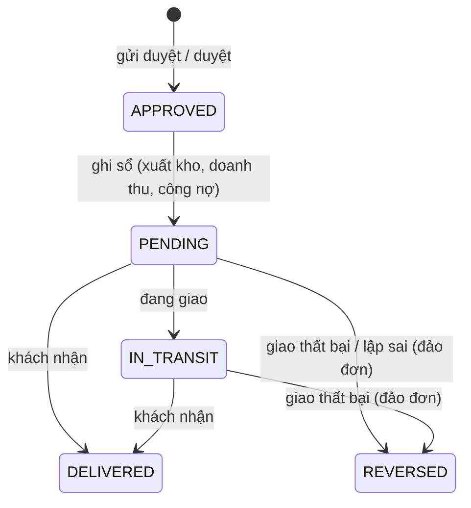

## 4. Chuỗi đấu thầu
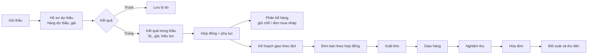
Kiểm soát: mỗi lần đặt, xuất, giao theo hợp đồng khóa dòng hợp đồng và kiểm tra `đã giao + lần này ≤ số lượng tối đa` (BR-TND-22, AT-07).

## 5. Ghi sổ (trong một transaction)
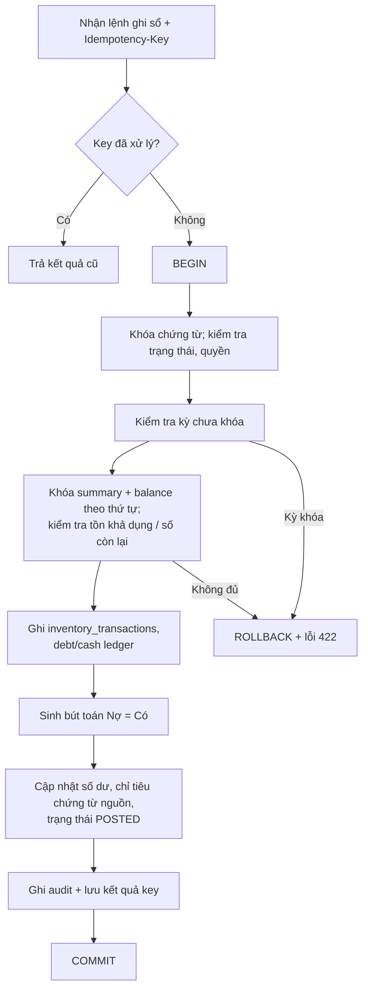

### 5.1 Sinh bút toán (Giai đoạn 4A, ADR-11)
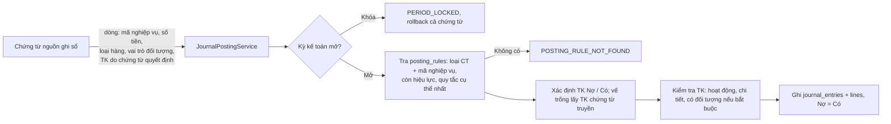
- Đảo chứng từ nguồn gọi `JournalPostingService.reverse`: khóa bút toán gốc, sinh bút toán đổi vế từng dòng vào ngày đảo, bút toán gốc chuyển `REVERSED`.
- Bút toán phiếu kho làm ở Giai đoạn 8 cùng tính giá vốn (D-51); Giai đoạn 4 sinh bút toán cho chứng từ tiền (4C). Công nợ đầu kỳ không sinh bút toán `[Giả định]`.

### 5.2 Thu chi, ngân hàng (Giai đoạn 4C, BR-CSH-02, 03, BR-AR-03)
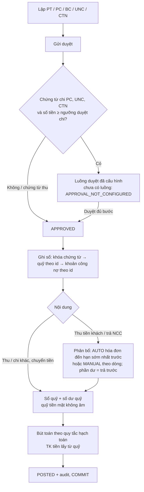
- Ngưỡng duyệt chi: tham số `finance.payment-approval-threshold` (mặc định 20.000.000 `[Giả định]`); người duyệt theo luồng duyệt của loại PC / UNC / CTN.
- Phân bổ trong cùng chi nhánh, cùng đối tượng, cùng loại công nợ; số còn lại của hóa đơn kiểm tra lại sau khi khóa (BR-GEN-52).
- Trả trước ghi sổ chi tiết công nợ loại `PREPAYMENT`, không gắn hóa đơn; đối trừ trả trước với hóa đơn làm ở 4D.
- Đảo (quyền `cash-document:reverse`, bắt buộc lý do): hoàn phân bổ vào hóa đơn, sổ quỹ ngược, bút toán đảo. Đảo phiếu thu mà tiền đã chi làm quỹ tiền mặt âm thì bị từ chối (`CASH_BALANCE_NEGATIVE`). Công nợ đầu kỳ đã được thu một phần không đảo được cho tới khi đảo phiếu thu (`HAS_DEPENDENT_DOCUMENTS`).

### 5.3 Bù trừ, điều chỉnh, tạm ứng, đối chiếu, kiểm kê quỹ (Giai đoạn 4D)
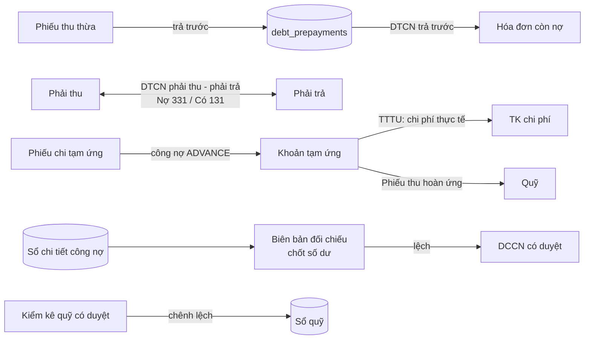
- Bù trừ, điều chỉnh, thanh toán tạm ứng, kiểm kê quỹ dùng vòng đời nhóm A chung; đảo bằng chứng từ đảo, không xóa (bỏ bù trừ = đảo DTCN).
- Đảo phiếu thu có trả trước đã bù trừ: `HAS_DEPENDENT_DOCUMENTS` (đảo chứng từ bù trừ trước). Đảo phiếu chi tạm ứng đã hoàn ứng / thanh toán: `HAS_DEPENDENT_DOCUMENTS`.
- Kiểm kê quỹ: số dư sổ quỹ tính đến hết ngày kiểm kê tại lúc ghi sổ (sau khi khóa quỹ); không chênh lệch thì không sinh sổ quỹ, bút toán.

## 6. Đảo chứng từ
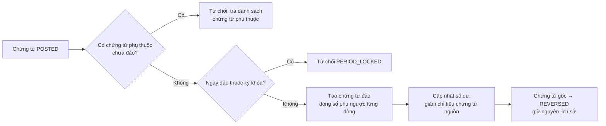

Đã làm cho chứng từ kho (Giai đoạn 3): thao tác "Đảo" lập chứng từ đảo PDK và gửi duyệt ngay; kiểm tra chứng từ phụ thuộc và kỳ khóa diễn ra **khi ghi sổ PDK** (lúc đó mới khóa số dư). Hàng của chứng từ gốc đã bị chứng từ khác xuất thì ghi sổ PDK báo `HAS_DEPENDENT_DOCUMENTS` kèm số chứng từ cần đảo trước. Hủy PDK thì chứng từ gốc đảo lại được.

### 6.1 Chứng từ kho (Giai đoạn 3)
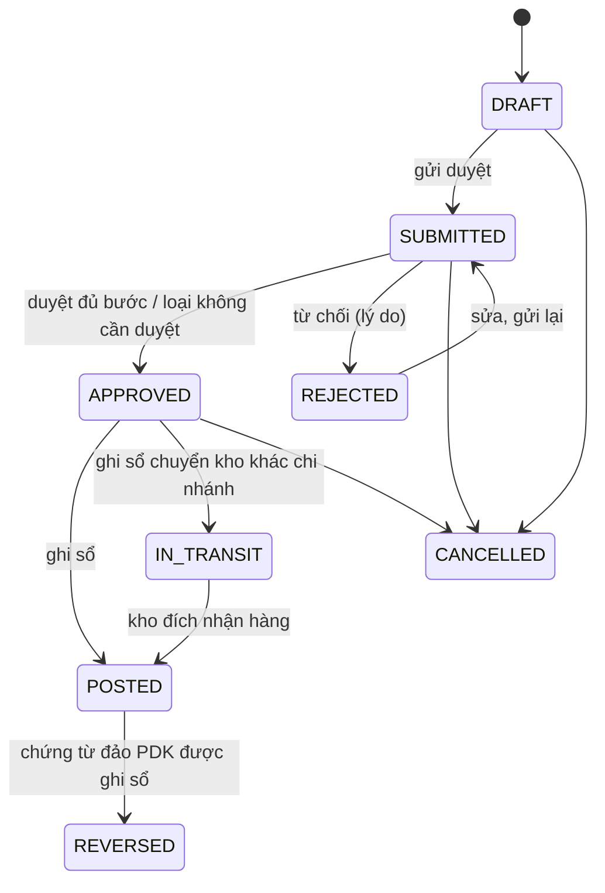
Chuyển kho khác chi nhánh: ghi sổ xuất khỏi kho nguồn và nhập vào kho "đang vận chuyển" của chi nhánh nguồn; người thuộc kho đích xác nhận nhận hàng thì xuất khỏi kho đang vận chuyển, nhập kho đích (đúng lô, serial, trạng thái).

## 7. Kiểm kê
```
DRAFT -> COUNTING (bắt đầu đếm: snapshot tồn theo vị trí/lô/serial/trạng thái; chặn ghi sổ nhập/xuất của kho)
      -> nhập số đếm (khi COUNTING; hàng tìm thấy ngoài sổ thêm dòng với tồn sổ sách 0)
      -> SUBMITTED (đủ số đếm) -> APPROVED -> POSTED (sinh phiếu điều chỉnh PDC loại COUNT theo chênh lệch, mở khóa kho)
SUBMITTED -> COUNTING khi bị từ chối (vẫn khóa kho); hủy ở bất kỳ bước chưa ghi sổ thì mở khóa kho
```

## 8. Khóa kỳ cuối tháng
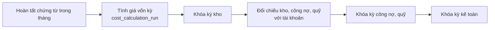
Mở lại kỳ: Kế toán trưởng hoặc Giám đốc duyệt, có lý do, ghi audit (BR-SYS-32).

## 9. Phê duyệt
- Ma trận duyệt cấu hình theo loại chứng từ, chi nhánh, ngưỡng giá trị/chiết khấu, số cấp (BR-SYS-11, D-04).
- Duyệt bắt buộc: giá dưới giá sàn, vượt hạn mức tín dụng, hợp đồng, giá dự thầu dưới biên, phiếu chi trên ngưỡng, điều chỉnh tồn, hủy hàng, thu hồi, đảo chứng từ, xuất vượt tồn khả dụng.
- Người lập không tự duyệt khi bật tách biệt nhiệm vụ.
- Mỗi bước duyệt/từ chối ghi `approval_history` và audit.
